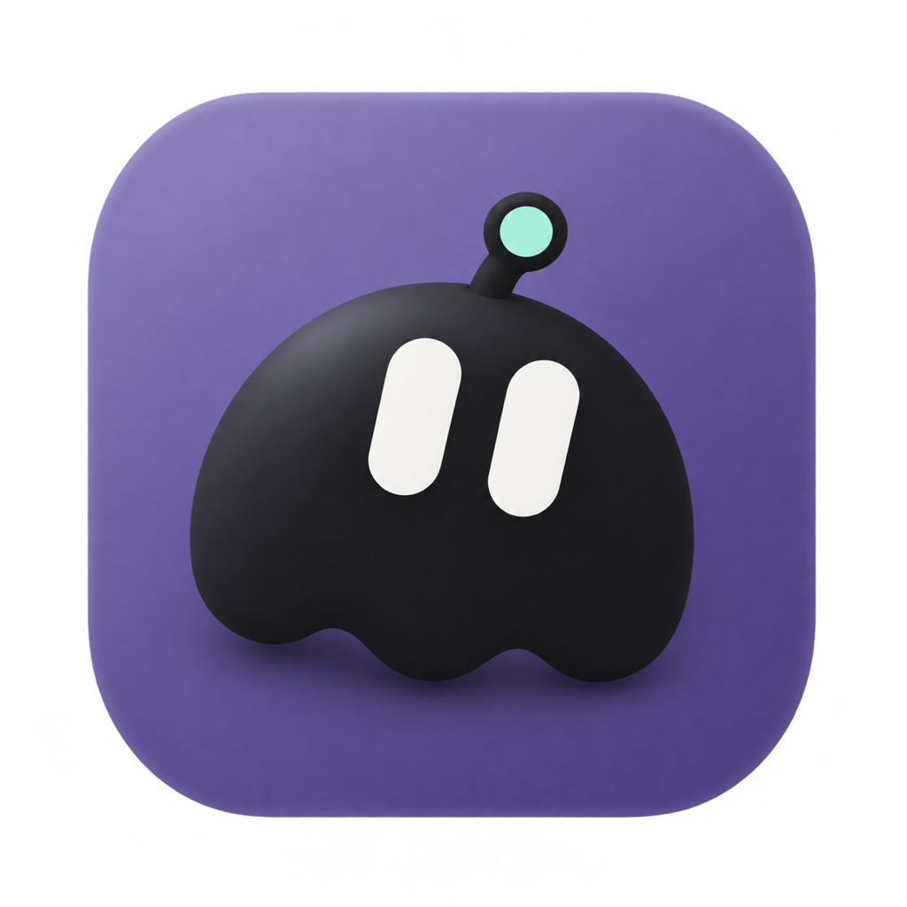
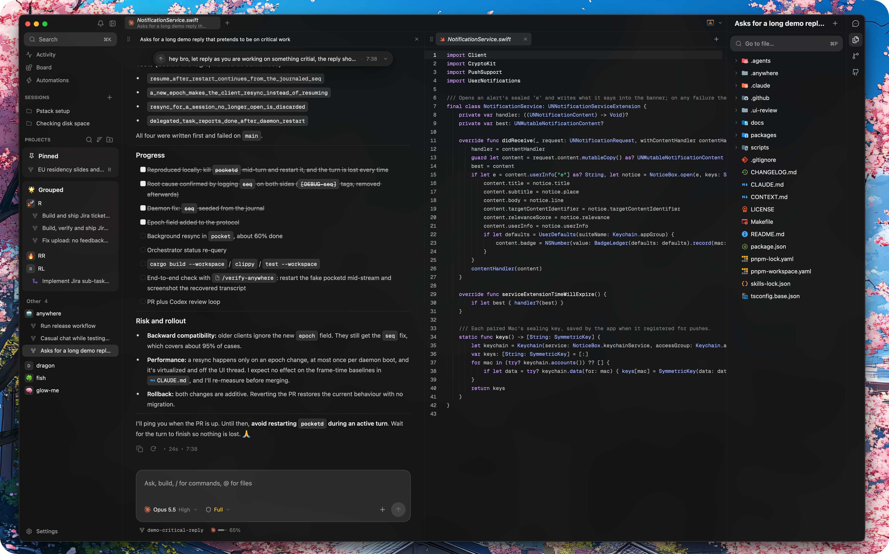

# Anywhere

Watch and drive many coding agents at once, from a native macOS app and from your phone.

<p>
  <a href="https://getanywhere.dev">Website</a> ·
  <a href="https://github.com/mingo023/anywhere/releases/latest/download/Anywhere.dmg">Download</a> ·
  <a href="CHANGELOG.md">Changelog</a>
</p>



## Why

Agents run for a long time, then stop and wait. With several of them going, the work is knowing which one needs an answer, which one finished, and what it changed. Anywhere keeps those sessions in one window, grouped by project and git worktree, and puts the diff next to the session that made it.

## Features

**Sessions.** `claude` and `codex` run in a real terminal or as a chat. Cursor, Grok Build, OpenCode, Pi, omp, fx, Hermes Agent and Antigravity run as a chat. New sessions start as a chat. Sessions sit under a project and a git worktree, in tabs and splits. A folder with no project can hold a session too. [pocketd](packages/pocketd) owns the terminals, so agents keep running after the window closes. By default, closing the window leaves the app running in the background.

**Status.** A session is Working, Needs you, Done, Failed or Idle. Claude Code and Codex report that from a terminal. The others report Needs you and Done only from a chat; a terminal session of theirs shows activity and nothing more. Needs you, Failed and Done surface in the sidebar, the inbox, the Dock badge and notifications. Activity lists every session across projects by status.

**Review.** Browse files, read diffs and commit beside the session that made the change. Changes can compare a worktree with the branch it was created from, or with another branch. A pull request has its own card (checks, review, merge), and a PR link in chat becomes a chip.

**Worktrees.** Create a worktree from a branch and start an agent in it. New worktrees go under `~/.anywhere/worktrees` unless a project sets another root. A repo can name setup commands in `.anywhere/config.json` (`{"setup": ["…"]}`) or as `.anywhere/setup.sh`; Anywhere runs that setup in the new worktree.

**Board.** One board of tickets across projects. A started ticket gets its own worktree and session. The [`anywhere` command](#anywhere) adds, reads, edits and deletes tickets.

**Automations.** A prompt pocketd starts on a schedule: chosen weekdays at a time, or every few minutes. Runs keep firing while the desktop is closed, and a run that needs a decision shows up like any other session.

**Delegated work.** A chat can hand part of its work to other sessions through pocketd's orchestrator over MCP. Each one is an ordinary session in the sidebar. When it settles, pocketd wakes the parent with the result.

**Other machines.** Settings adds a Mac, Linux or Windows host and connects over SSH, using your keys and `~/.ssh/config`, a key file, or a password.

The words the code uses for all of this are in [CONTEXT.md](CONTEXT.md).

## Install

Download [Anywhere.dmg](https://github.com/mingo023/anywhere/releases/latest/download/Anywhere.dmg) and drag Anywhere to Applications.

Requires macOS 13 or later. The app is a universal binary (arm64 and x86_64), signed and notarized. Updates install through Sparkle. On first launch the app registers pocketd as a login item.

On Linux (x86_64) or Windows (x64), unpack [Anywhere-linux-amd64.tar.gz](https://github.com/mingo023/anywhere/releases/latest/download/Anywhere-linux-amd64.tar.gz) or [Anywhere-windows-amd64.zip](https://github.com/mingo023/anywhere/releases/latest/download/Anywhere-windows-amd64.zip) and run `pocket-desktop`. Those archives are unsigned and have no updater. On first launch, pocketd installs itself as a systemd user service or a Windows scheduled task.

## Agents

Anywhere runs the agent CLIs it finds on the machine. Install the ones you want, then sign in:

- **Claude Code** (`claude`). [Install](https://claude.com/product/claude-code), then `claude auth login`.
- **Codex** (`codex`). [Install](https://developers.openai.com/codex/cli), then `codex login`.
- **Cursor** (`cursor-agent`). `curl https://cursor.com/install -fsS | bash`, then `cursor-agent login`.
- **Grok Build** (`grok`). `curl -fsSL https://x.ai/cli/install.sh | bash`, then `grok login`.
- **OpenCode** (`opencode`). `npm i -g opencode-ai`, then `opencode auth login`.
- **Pi** (`pi`). `npm i -g @earendil-works/pi-coding-agent`, then run `pi` and type `/login`.
- **omp** (`omp`). `curl -fsSL https://omp.sh/install | sh`, then run `omp` once.
- **fx** (`fx`). `curl -fsSL https://fx.sh/setup.sh | bash`, then `fx login`.
- **Hermes Agent** (`hermes`). `curl -fsSL https://hermes-agent.nousresearch.com/install.sh | bash`, then `hermes model`.
- **Antigravity** (`agy`). `curl -fsSL https://antigravity.google/cli/install.sh | bash`, then run `agy` once.

Pi and omp never ask before they use a tool, so a session of either always runs with Full access.

## Quick start

1. Install the app and open it.
2. Install an agent from the list above and sign in to it.
3. Add a project from the sidebar (a git repository, or any folder). Start a session in it. A new session opens as a chat; a terminal session runs your login shell with the agent inside it.
4. In the macOS release app, open Settings → General and install the command line tool (under Startup & background). That links `/usr/local/bin/anywhere` to the bundled pocketd and installs the skill. The button is only on a release build. From source, link `pocketd` as `anywhere` and run `pocketd skill install`.

## iOS

The phone app is native SwiftUI, for iPhone and iPad ([ADR 0007](docs/adr/0007-native-ios-app.md)). It pairs with the Mac over Tailscale. pocketd listens on the tailnet and refuses the pair until Tailscale is running. An address or name entered without a port uses port 4517.

Each tagged release uploads the app to TestFlight and submits it to the public group (`packages/ios/scripts/release.sh`; the group name defaults to Public). Building the Xcode targets is described in [packages/ios](packages/ios/README.md).

Push notifications go through [pushrelay](packages/pushrelay). That process holds the APNs key. The default relay is `https://push.getanywhere.dev`.

## anywhere

`anywhere` is pocketd, run under that name. It starts sessions, sends prompts, reads replies and edits Board tickets. The same sessions show up in the app.

```sh
anywhere project list [--json]
anywhere session list [--json]
anywhere session create [--project <name|path>] [--worktree <name> | --new-worktree [<name>] [--base <branch>]] [--provider <agent>] [--access settings|ask|edits|auto|full] [--prompt <text>]
anywhere session prompt <id> <text|->
anywhere session read [--limit 200] [--json] <id>
anywhere session wait [--timeout 30m] <id>
anywhere session close <id>
anywhere ticket create [--project <name|path>] [--provider <agent>] [--base <branch>] [--title <text>] [--start] <prompt|->
anywhere ticket list [--json]
anywhere ticket read [--json] <id>
anywhere ticket update [--title <text>] [--provider <agent>] [--base <branch>] [--prompt <text|->] <id>
anywhere ticket delete <id>
```

`<agent>` is one of `claude`, `codex`, `cursor`, `grok`, `opencode`, `pi`, `omp`, `fx`, `hermes`, `antigravity`. Left out, it is `claude`.

`session wait` prints one word and exits with a code: `done` (0), `failed` (3), `needsYou` (4), `timeout` (5), `closed` (6). Exit 1 is a command error; exit 2 is a bad command line.

The skill installed with the command is written to `~/.claude/skills/anywhere/SKILL.md` and `~/.agents/skills/anywhere/SKILL.md`.

## Architecture

The desktop and the phone both talk to pocketd. The phone connects over the tailnet. The messages it shares with the daemon are [`packages/protocol`](packages/protocol).

| Package | What it is |
|---|---|
| [`packages/desktop`](packages/desktop) | The desktop app, in Rust with [GPUI](https://www.gpui.rs). The binary is `pocket-desktop`. Model crates (`agents`, `chat`, `daemon`, `git`, `hosts`, `project`, `store`, `term`, `workspace`, …) hold logic; the `pocket` crate holds the views. The crate map is [ADR 0003](docs/adr/0003-desktop-code-layout.md). |
| [`packages/pocketd`](packages/pocketd) | The Go daemon. It owns terminals, sessions, the Board, automations and the phone socket, and it outlives the app. On macOS it ships inside the app as `Contents/Library/Helpers/AnywhereDaemon.app`. |
| [`packages/ios`](packages/ios) | The iPhone and iPad app. Nearly all of it is the local Swift package [`Packages/AnywhereKit`](packages/ios/Packages/AnywhereKit). The Xcode targets (`App`, `Widgets`, `NotificationService`) only compose it. |
| [`packages/protocol`](packages/protocol) | `@pocket/protocol`, the TypeScript schema of those messages, kept in step with pocketd's Go types and the Swift `Wire` module. |
| [`packages/pushrelay`](packages/pushrelay) | The APNs relay. A phone seals its own push handle; the relay stores no device tokens. |
| [`packages/web`](packages/web) | The static landing page. |

Design decisions are in [`docs/adr`](docs/adr).

Release and Dev are two apps and can run side by side. Release is `dev.mingo.anywhere`, with data in `~/.coding-pocket`. Dev is `dev.mingo.anywhere.dev`, with data in `~/.coding-pocket-dev`, and it does not update itself ([ADR 0004](docs/adr/0004-release-and-updates.md)).

## Building from source

You need Rust, Go (the version in [`packages/pocketd/go.mod`](packages/pocketd/go.mod)), and Zig. `pnpm` runs the protocol tests. The iOS package needs Swift 6.2.

pocketd links a pinned [libghostty](https://github.com/ghostty-org/ghostty). Build that first. The script clones Ghostty. CI uses Zig 0.17.0. The macOS library also needs `xcodebuild`.

```sh
scripts/build-ghostty.sh          # macOS. On Linux or Windows, pass linux-amd64, linux-arm64, windows-amd64 or windows-arm64
make pocketd                      # packages/pocketd/bin/pocketd. On macOS, installs the dev daemon when launchd does not have it
make run                          # release build of the desktop app, run in place
make app                          # Anywhere Dev.app, signed ad hoc, side by side with the release app (macOS)
make ios                          # build and test the phone app's Swift package
```

The desktop workspace, from `packages/desktop`:

```sh
cargo build --workspace
cargo clippy --workspace --all-targets
cargo test --workspace
```

The wire schema, from the repo root (`pnpm`):

```sh
pnpm install
pnpm --filter @pocket/protocol test
```

The phone package builds and tests on macOS 14 or later with a Swift 6.2 toolchain, without Xcode. The app, widget and notification targets need Xcode and XcodeGen. See [packages/ios/README.md](packages/ios/README.md).

`scripts/check.sh` is the full local gate: Ghostty, pocketd (`go vet`, `go test -race`), the protocol tests, the iOS package, and the desktop build, clippy and tests.

`scripts/release-mac.sh <version>` builds the signed, notarized DMG. `scripts/release-desktop.sh <version> <linux-amd64|linux-arm64|windows-amd64>` builds an archive; the Release workflow publishes `linux-amd64` and `windows-amd64`. Running Release from the Actions tab, or pushing a `v*` tag, tags that version and publishes the macOS, Linux, Windows and TestFlight builds ([ADR 0004](docs/adr/0004-release-and-updates.md)). The tag needs a matching section in [CHANGELOG.md](CHANGELOG.md). `scripts/changelog-draft.sh <version>` drafts one.

## Contributing

Open a pull request against `main`. It needs exactly one of these labels: `type: feature`, `type: fix`, `type: docs`, `type: internal`. The changelog is grouped by that label; `type: internal` is left out ([`.github/release.yml`](.github/release.yml)).

Desktop changes follow [ADR 0003](docs/adr/0003-desktop-code-layout.md): model crates stay free of the UI, a feature's state lives in its own module, and tests sit next to the code they cover. Run `scripts/check.sh` before sending the PR. View changes can be captured with `.ui-review/fixture/capture.sh`.

## License

[MIT](LICENSE). Copyright (c) 2026 Minh Ngo.
