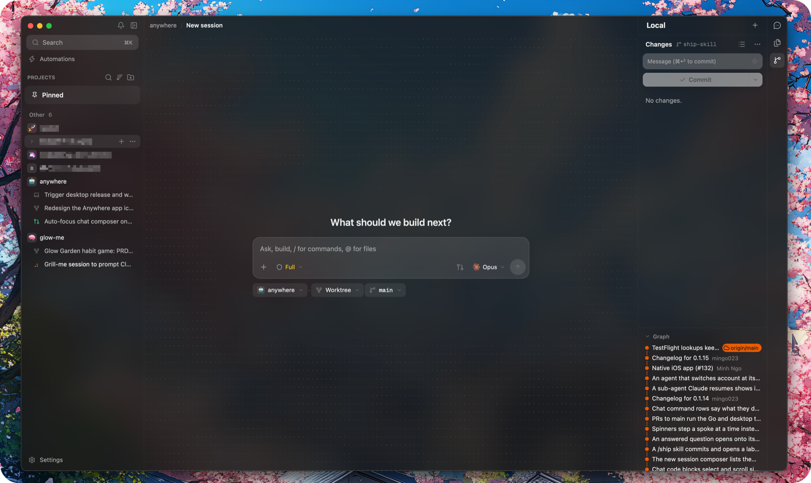

<h1 align="center">Anywhere</h1>

<p align="center">
  Watch and drive your Claude Code and Codex agents, from your Mac and your phone.
</p>

<p align="center">
  <a href="https://getanywhere.dev">Website</a> ·
  <a href="https://github.com/mingo023/anywhere/releases/latest/download/Anywhere.dmg">Download</a> ·
  <a href="CHANGELOG.md">Changelog</a>
</p>



Anywhere is a native macOS app for running many coding agents at once. Every `claude` and `codex` session runs in a real terminal, grouped by project and git worktree, and Anywhere tells you which ones are working, which need you and which are done.

## Features

- **Every agent, one window.** Real terminals in tabs and splits, grouped by project and worktree.
- **Know who needs you.** Status in the sidebar, inbox, Dock badge and notifications; jump straight to the session that's asking.
- **Review beside the terminal.** Browse files, read diffs and commit without leaving the session that made the change.
- **Worktrees from a branch or PR.** Create a worktree and start an agent in it, with your setup script run for you.
- **Automations.** Schedule Claude Code or Codex runs, and get told when one needs a decision.
- **Sessions that survive.** A daemon owns the terminals, so agents keep running when you close the window.
- **On your phone, too.** Answer an agent from anywhere; your phone reaches your Mac over Tailscale.

## Install

Download [Anywhere.dmg](https://github.com/mingo023/anywhere/releases/latest/download/Anywhere.dmg) and drag Anywhere to Applications.

Requires macOS 13 or later. Updates install automatically through Sparkle.

On Linux (x86_64) or Windows (x64), unpack [Anywhere-linux-amd64.tar.gz](https://github.com/mingo023/anywhere/releases/latest/download/Anywhere-linux-amd64.tar.gz) or [Anywhere-windows-amd64.zip](https://github.com/mingo023/anywhere/releases/latest/download/Anywhere-windows-amd64.zip) and run `pocket-desktop`. These builds are unsigned and don't update themselves.

## Architecture

| Package | What it is |
|---|---|
| [`packages/desktop`](packages/desktop) | The desktop app, in Rust with [GPUI](https://www.gpui.rs) |
| [`packages/pocketd`](packages/pocketd) | The Go daemon that owns the terminals and outlives the app |
| [`packages/ios`](packages/ios) | The phone app, native SwiftUI ([ADR 0007](docs/adr/0007-native-ios-app.md)) |
| [`packages/protocol`](packages/protocol) | The protocol the daemon and its clients share |

Design decisions are recorded in [`docs/adr`](docs/adr), and the vocabulary used across the code in [`CONTEXT.md`](CONTEXT.md).

## Build from source

```sh
make app        # Anywhere Dev.app, side by side with the release app
make run        # release build of the desktop app, run in place
make ios        # build and test the phone app's Swift package
```

The phone app's targets need Xcode; [`packages/ios`](packages/ios/README.md) says how to build them.

`scripts/release-mac.sh <version>` builds the signed, notarized DMG and `scripts/release-desktop.sh <version> <linux-amd64|windows-amd64>` the Linux and Windows archives. Running the Release workflow from the Actions tab, or pushing a `v*` tag, publishes all three ([ADR 0004](docs/adr/0004-release-and-updates.md)).
