# User stories: Light Factory

| | |
|---|---|
| Source | `docs/designs/2026-11-12-light-factory.md`, Draft v3, 2026-11-12 |
| Scope | v1, milestones M0 to M6. Deferred work is listed in [Not in v1](#not-in-v1). |
| Status | Draft for review |

## How to read this document

Each story has an ID, a title, the story sentence, and acceptance criteria. The last line of a story names the PRD requirements that the story covers, the priority, and the milestone. The [coverage table](#coverage) maps every PRD requirement to a story.

The stories use the PRD vocabulary: Factory, station, gate, Ask, auto-fix, reviewer, slot, lead, worker, profile.

**The developer** is the one user: a person who runs 3 to 8 agent tickets on one Mac and reviews all of the output. The same person answers from the iPhone when away from the desk. An agent is not a user. An agent can read Factory state and can never decide anything.

The stories state behaviour. They do not state colour, size, or typeface. The visual treatment follows the Anywhere design system, as the prototype in `.ui-review/prototypes/light-factory/` shows.

## Decisions after review

1. **The look follows the Anywhere app.** Needs-you is amber, status uses the coloured glyphs of the Board, labels are chips with a coloured dot, and merged is violet. PRD §11, B6, B7, and decision 5 now say so.
2. **The card has four rows, like the Board card of the app.** PRD B5 has no fixed height.
3. **The prototype follows the PRD.** It has no "Always allow on this task" button (I4, N7) and no Factory item in the sidebar (B14, decision 14).
4. **The metrics strip sits at the top of Settings → Factory.** The Board has no metrics strip (B9, §9).
5. **A slot count above the limit is correct behaviour.** I5 and E16 let a ticket resume above the limit. US-23 treats `6/4 slots` as expected.

## Board

### US-01 See every ticket's station on one screen

As the developer, I want the Board to show each ticket under its station, so that I see the whole pipeline without opening a ticket.

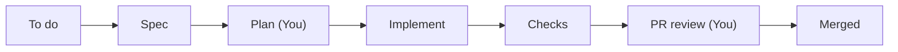

- The Board has three layout tabs under the breadcrumb: **Factory**, **Status**, and **List**.
- The Factory layout shows seven columns in a fixed order: To do, Spec, Plan, Implement, Checks, PR review, Merged.
- Each ticket appears in exactly one column.
- Each column header shows the station name and the number of tickets in the column.
- A queued ticket appears in To do.
- The Plan header and the PR review header each show a "You" marker.
- Urgency never changes the order of the columns.
- For a project with the Factory off, the Status layout and the List layout work as they do today.

PRD: B1, B2, B4, B13, N3 · P0 · M1

### US-02 See all seven stations at 1280px

As the developer, I want every station visible on a 1280px window, so that no working station is off screen.

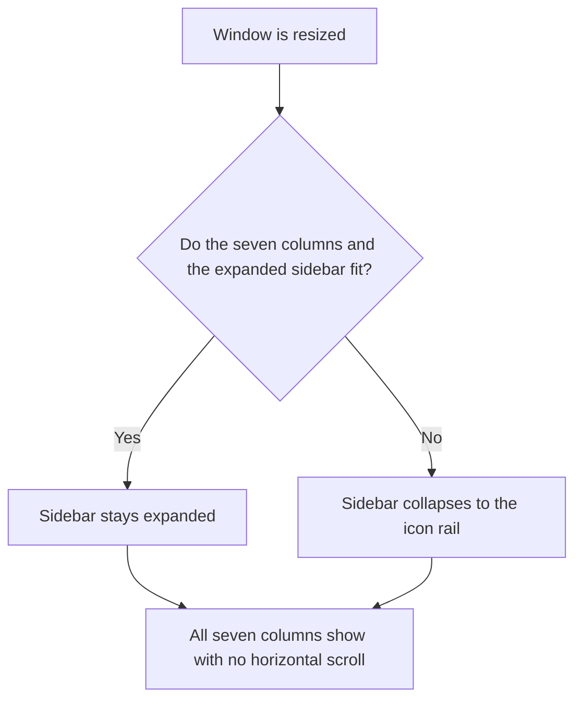

- To do and Merged are 44px rails. A rail shows the station name and the ticket count.
- The five middle columns are 196 to 248px wide, with a 12px gap.
- At a window width of 1280px with the sidebar collapsed, all seven columns fit with no horizontal scroll.
- If the columns and the expanded sidebar do not fit, the sidebar collapses. The Board never hides a working station.
- The expanded sidebar is 212 to 280px wide. The chevron and the `]` key collapse the sidebar to an icon rail.

PRD: B2, B3, B14 · P0 · M1

### US-03 Read a ticket's state from its card

As the developer, I want a card to say what the ticket is doing, so that I know which tickets wait on me without opening them.

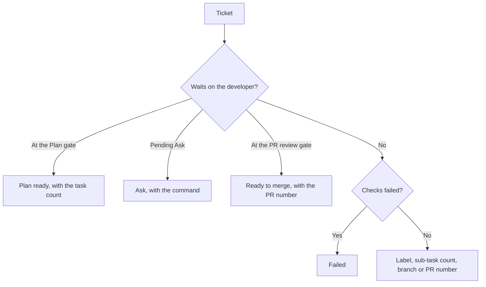

- A card has four rows, in this order:
  1. The ticket ID and the agent.
  2. The status and the title. The title takes two lines at most.
  3. One note: what the ticket waits for, the pending command, or the failure.
  4. The priority, the labels, the project, the sub-task count such as `2/3`, and the branch or the PR number.
- A card for a ticket that waits on the developer shows exactly one status string: `Plan ready · 3 tasks`, `Ask · 1/2`, or `Ready to merge · #203`.
- A card for a ticket with a pending Ask shows the command, for example `Ask · cargo test -p daemon`.
- A card for a failed ticket shows the word "Failed".
- A card has no button that decides anything.
- Within a column, tickets that wait on the developer come first, then failed tickets, then the oldest ticket first.

PRD: B5, B6, B7, B8, B13, I7 · P0 · M1

### US-04 Filter the Board to what needs me

As the developer, I want one click to show only the tickets that wait on me, so that I clear my own queue first.

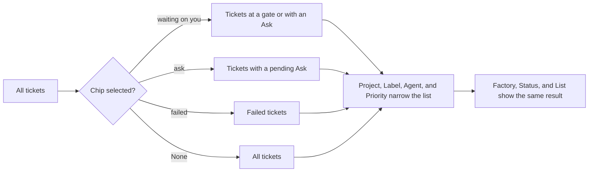

- The filter bar shows three chips with counts: `waiting on you`, `ask`, and `failed`.
- A click on a chip shows only the matching tickets. A second click on the same chip clears the filter. (The second click is from the prototype, not from the PRD.)
- The filter bar shows the slots in use and the slot limit as text, for example `3/4 slots`.
- The filter bar has four pickers, **Project**, **Label**, **Agent**, and **Priority**, and a **Display** control.
- A filter applies to all three layouts.

PRD: B9, N3 · P0 · M1

### US-05 Start a ticket into the pipeline

As the developer, I want a started ticket to enter the pipeline, so that I do not move the ticket between tools by hand.

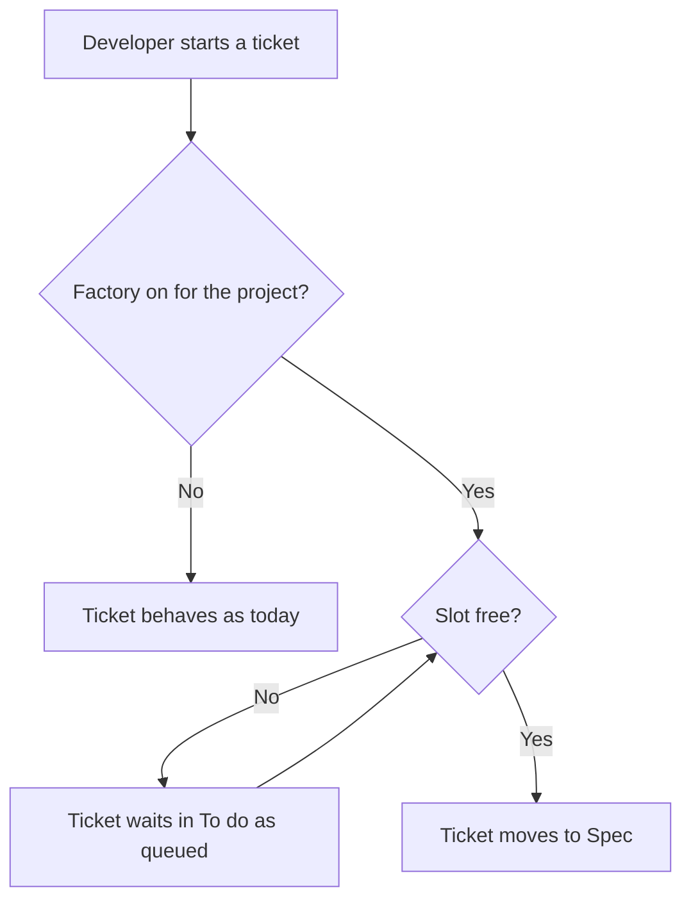

- **New ticket** opens the existing composer. The keyboard flow of the composer does not change.
- When the developer starts a ticket on a project with the Factory on, the ticket moves to Spec as soon as a slot is free.
- If no slot is free, the ticket waits in To do as queued.
- The developer can start a ticket from the composer, from the card, and from the `anywhere` CLI.
- Nothing else starts a ticket. A label, a CI failure, and a review comment do not start a ticket.
- When the developer starts a ticket on a project with the Factory off, the ticket behaves as it does today.

PRD: B15, N2, E17, decision 10 · P0 · M2

### US-06 Find a ticket with ⌘K

As the developer, I want a command menu, so that I reach a ticket or a view from the keyboard.

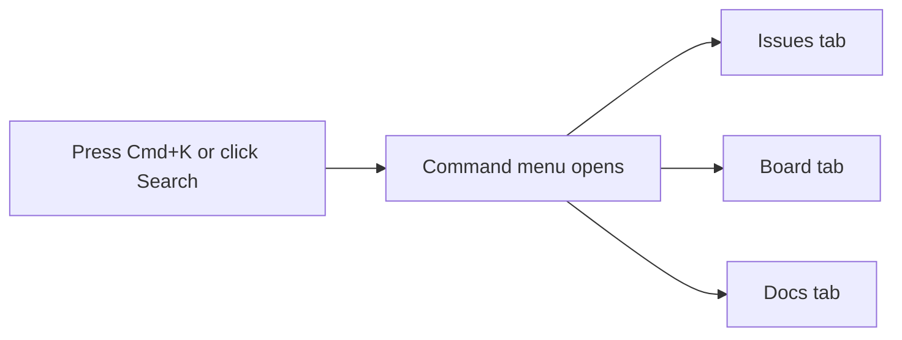

- The **Search** field shows a `⌘K` keycap.
- `⌘K` and a click on **Search** both open the command menu.
- The command menu has three tabs: **Issues**, **Board**, and **Docs**.

PRD: B10 · P1 · M6

### US-07 Group the Status and List layouts by station

As the developer, I want the other two layouts grouped by station, so that the pipeline reads the same way in every layout.

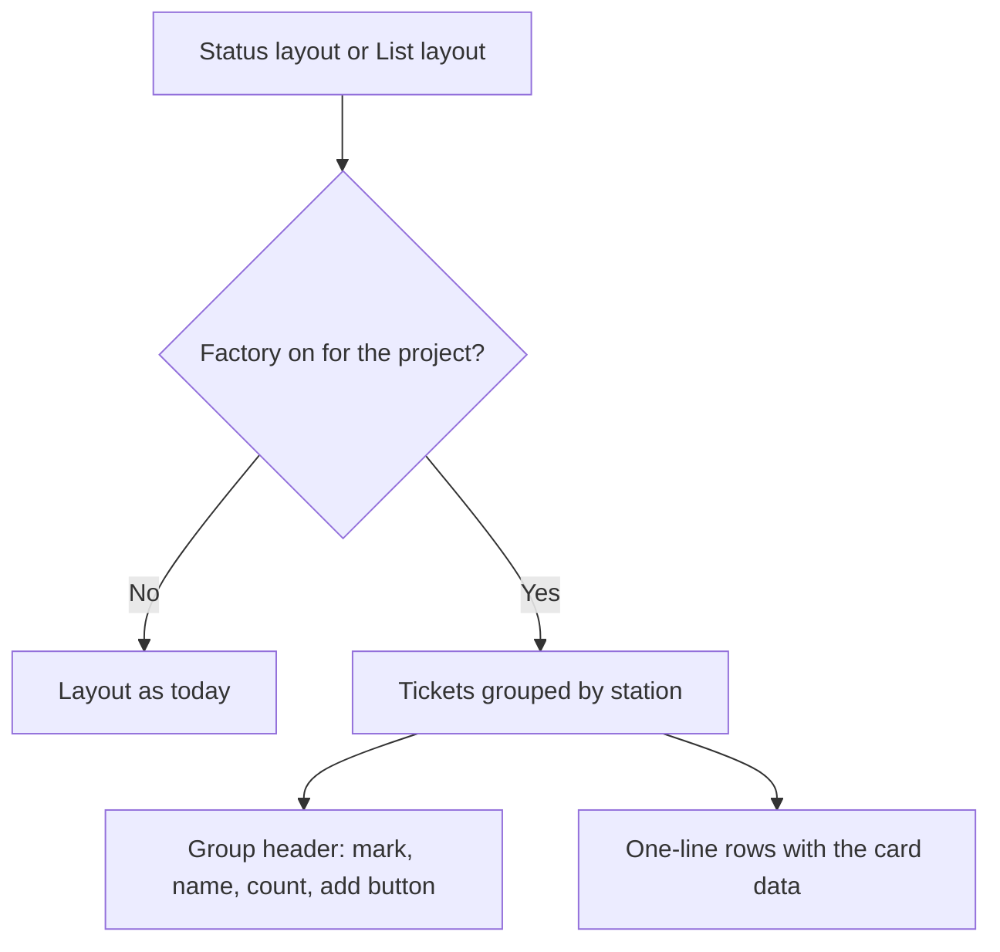

- For a project with the Factory on, the Status layout and the List layout group tickets by station.
- A group header shows the station mark, the station name, the ticket count, and an add button.
- A row is one line and shows the same data as a card.

PRD: B11 · P1 · M6

### US-08 Hide a station

As the developer, I want to hide a station that I do not watch, so that the Board shows only the columns that I use.

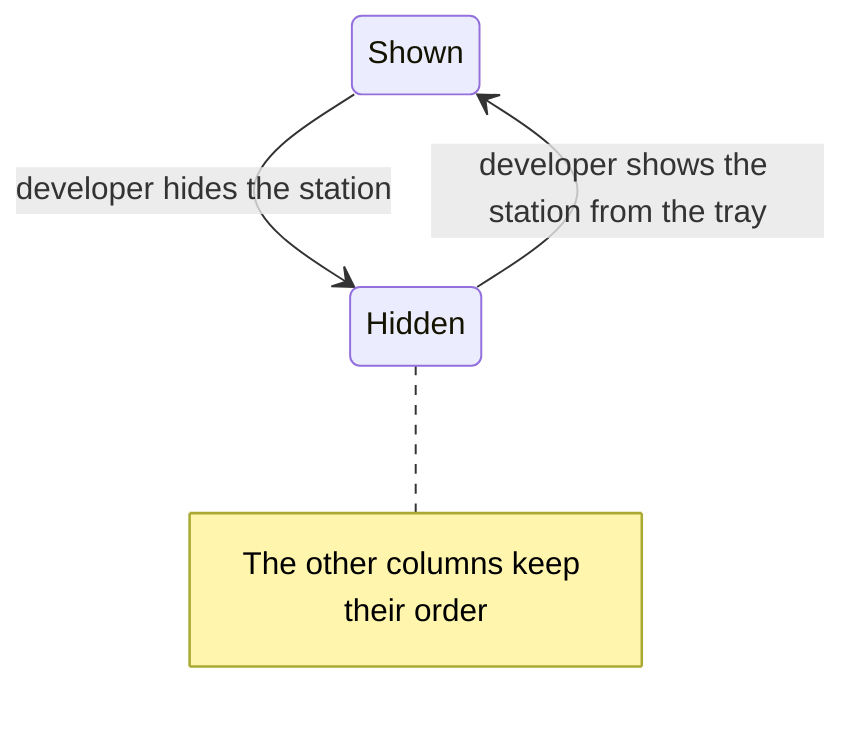

- The developer can hide a station and show it again from the hidden-column tray.
- A hidden station does not change the order of the other columns.

PRD: B12 · P2 · later

### US-09 Reach every list from the sidebar

As the developer, I want the sidebar to list my queues, projects, and agents, so that I move between them with one click.

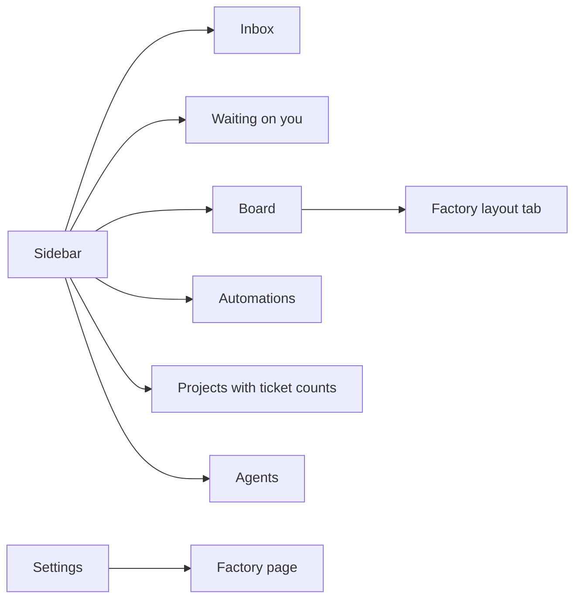

- The sidebar has four navigation rows with counts: **Inbox**, **Waiting on you**, **Board**, and **Automations**.
- The sidebar lists each project with its ticket count, and a group of agents.
- The sidebar has no Factory item. The Factory is a layout tab on the Board. The Factory configuration is in **Settings**, on the **Factory** page.

PRD: B14, decision 14 · P1 · M1

## Ticket page

### US-10 See where a ticket is and what it holds

As the developer, I want one page per ticket that opens on the right tab, so that I see the work of the current station first.

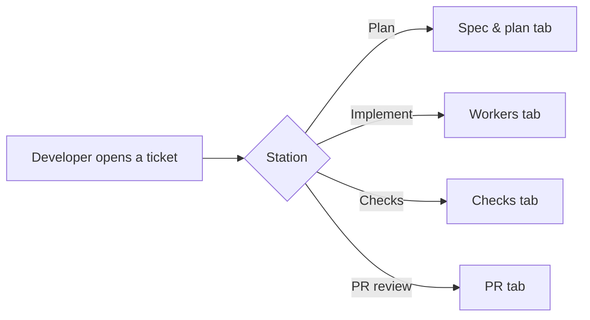

- The header shows the breadcrumb `Anywhere / Board / ANY-44`, the title, and one status line such as `Plan · waiting for you`.
- The Properties panel shows Project, ID, Type, Priority, Assignee, Agent, Labels, Branch, PR, created, and updated.
- An empty property shows the action that fills it, for example `Add label`.
- A label comes from the fixed set: Bug, Feature, Docs, Infra.
- The default tab follows the station. Plan opens **Spec & plan**. Implement opens **Workers**. Checks opens **Checks**. PR review opens **PR**.

PRD: T1, T2, T5 · P0 · M1

### US-11 See the plan tasks and the workers

As the developer, I want each plan task as a row with its state, so that I see how far Implement is.

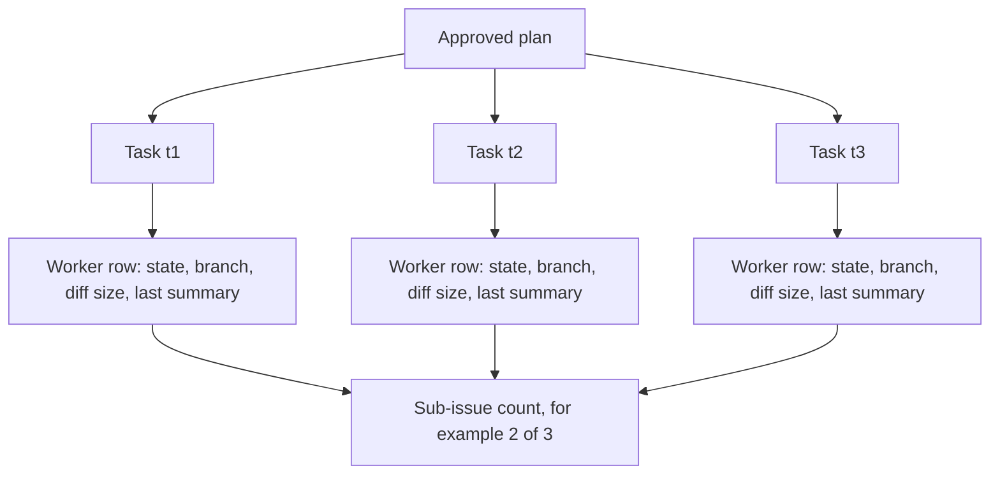

- Every ticket lists its plan tasks as sub-issues, with a count such as `2/3`.
- A sub-issue row shows the state, the title, the agent, the branch, and the status.
- The **Workers** tab shows each worker with its state, its branch, its diff size, and its last summary.

PRD: T3, T7 · P0 · M1

### US-12 Read what happened on a ticket

As the developer, I want a timeline of the ticket, so that I can check who did what and when.

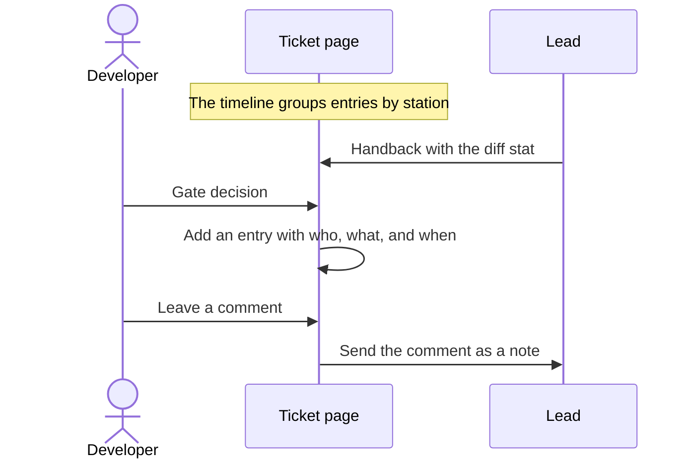

- The Activity timeline groups entries by station.
- An entry shows the actor, the action, and the relative time.
- A handback entry shows the output of `git diff --stat`. The timeline also shows each auto-allowed command, each check result, and each reviewer finding.
- Each gate decision is an entry that shows who decided, what, and when.
- The developer can leave a comment. Anywhere sends the comment to the lead as a note.

PRD: T4, decision 13 · P1 · M6

### US-13 Decide in one place

As the developer, I want every decision in the same bar, so that I never search for the control that unblocks a ticket.

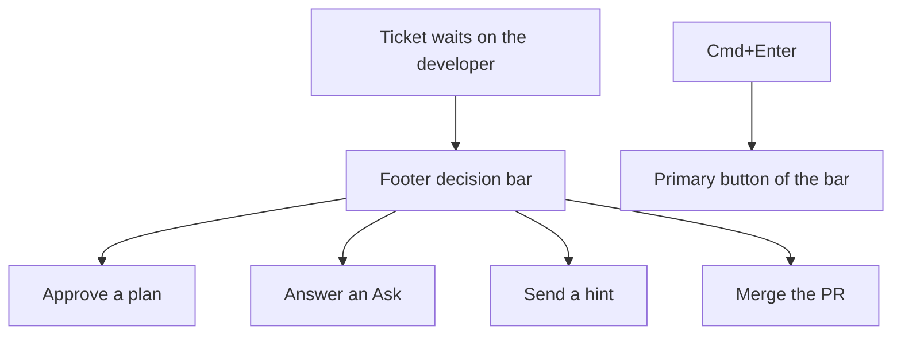

- A ticket that waits on the developer shows one footer decision bar. The bar stays at the bottom of the ticket page.
- The footer decision bar is the only place to approve a plan, answer an Ask, send a hint, or merge.
- `⌘↵` triggers the primary button of the footer decision bar.

PRD: T10, G2 · P0 · M2

## Spec station

### US-14 Get a spec before the plan

As the developer, I want the lead to write a spec first, so that the plan and the review have acceptance criteria to refer to.

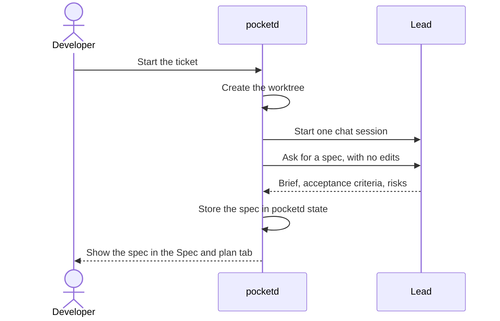

- When a ticket starts, pocketd creates the worktree of the ticket and one chat session, the lead.
- The lead reads the code and writes a spec: a brief, acceptance criteria, and risks. The lead edits no file at this station.
- The **Spec & plan** tab shows the spec as a document: the title, a byline such as `Spec · Claude · 14:02`, the brief, and the acceptance criteria as a checklist. The plan follows as sub-issues.
- pocketd keeps the spec in its own state. The spec is not committed to the worktree.
- The same lead session writes the plan, leads the workers, and does the auto-fix attempts.

PRD: S1, S2, S3, T6, decisions 1 and 12 · P0 · M2

### US-15 See why a spec failed

As the developer, I want a ticket without a valid spec to say so, so that the ticket does not wait in Spec with no explanation.

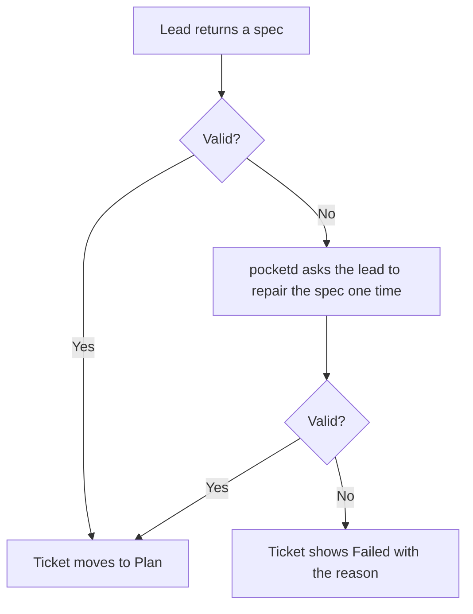

- If the lead returns no valid spec, pocketd asks the lead to repair the spec one time.
- If the second answer is also not valid, the ticket shows Failed with the reason.

PRD: S4 · P0 · M2

### US-16 Turn the Spec station off for a project

As the developer, I want to skip the spec on a project with small tickets, so that those tickets reach the Plan gate sooner.

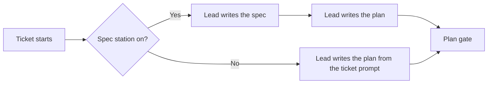

- With the Spec station off, the lead writes the plan from the prompt of the ticket.
- The Plan gate stays on. An agent cannot skip a gate, even when the agent calls the work trivial.

PRD: S5, E13 · P1 · M6

## Plan gate

### US-17 Review and edit the plan before a worker starts

As the developer, I want to change the plan at the gate, so that the workers start on the work that I agreed to.

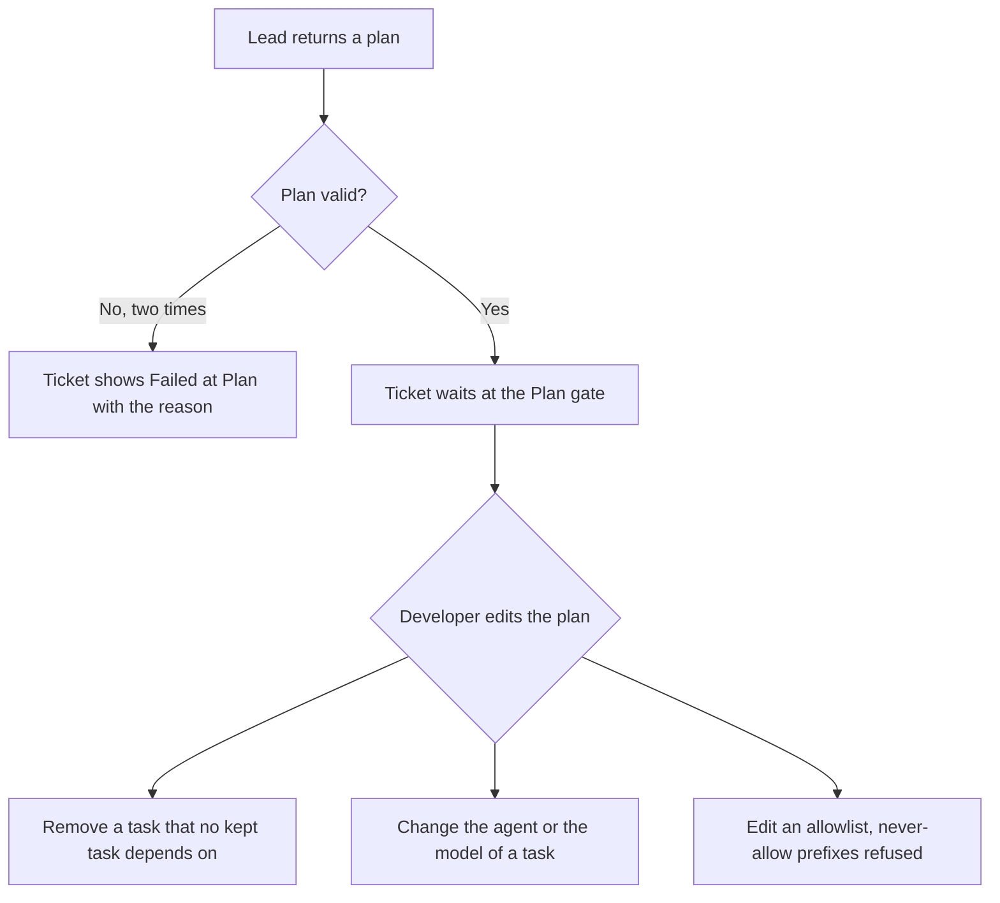

- A ticket with a valid plan waits at the Plan gate. The ticket shows as waiting on the developer in the sidebar, in the Dock badge, and on the phone.
- The developer can remove a task. The developer cannot remove a task that another kept task depends on.
- The developer can change the profile of a task. The profile sets the provider and the model of the task.
- The developer can edit the allowlist of a task. The allowlist refuses the prefixes on the never-allow list (US-24).
- The title, the instructions, and the order of a task are fixed.
- If two tasks share a file, plan validation rejects the plan. If validation fails two times, the ticket shows Failed at Plan with the reason.

PRD: P1, P2, PF6, E3, E9, I6 · P0 · M2

### US-18 Approve the plan and start the workers

As the developer, I want no worker to start until I approve, so that agents never approve their own plan.

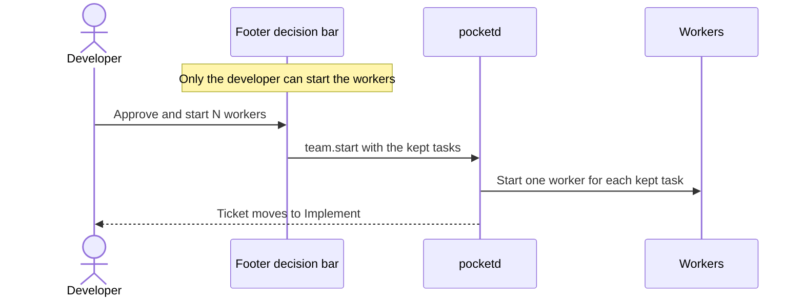

- The footer decision bar shows **Request changes** and **Approve and start N workers**. N is the number of kept tasks.
- The bar states that only the developer can start the workers.
- **Approve and start N workers** starts the kept tasks and moves the ticket to Implement.
- The Plan gate cannot be turned off.

PRD: P3, P4, P6, decision 16 · P0 · M2

### US-19 Send the plan back with a note

As the developer, I want to ask for a different plan in my own words, so that I do not have to rewrite the plan myself.

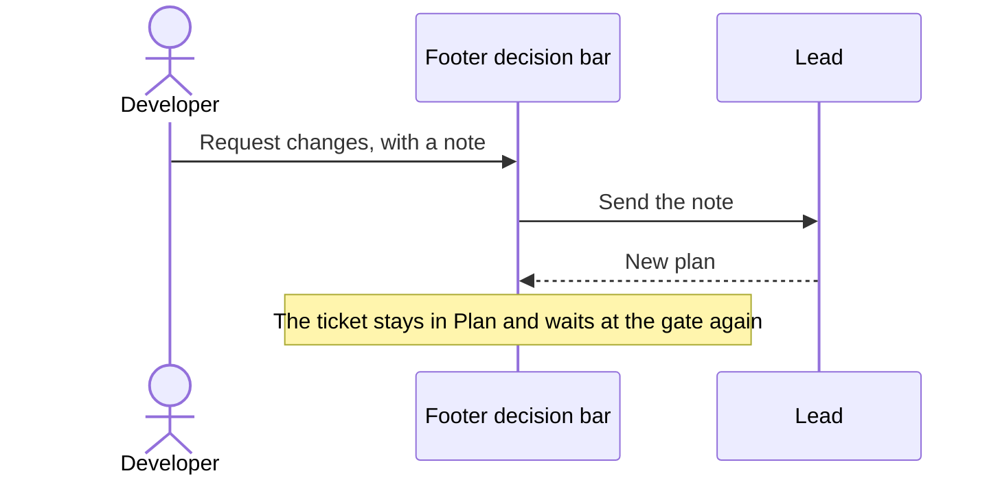

- **Request changes** takes a note from the developer and sends the note to the lead.
- The lead writes a new plan. The ticket stays in Plan and waits at the gate again.

PRD: P5 · P0 · M2

## Implement and Ask

### US-20 Let the workers run in parallel

As the developer, I want the workers to do the approved tasks without me, so that I am needed only at a gate or for an Ask.

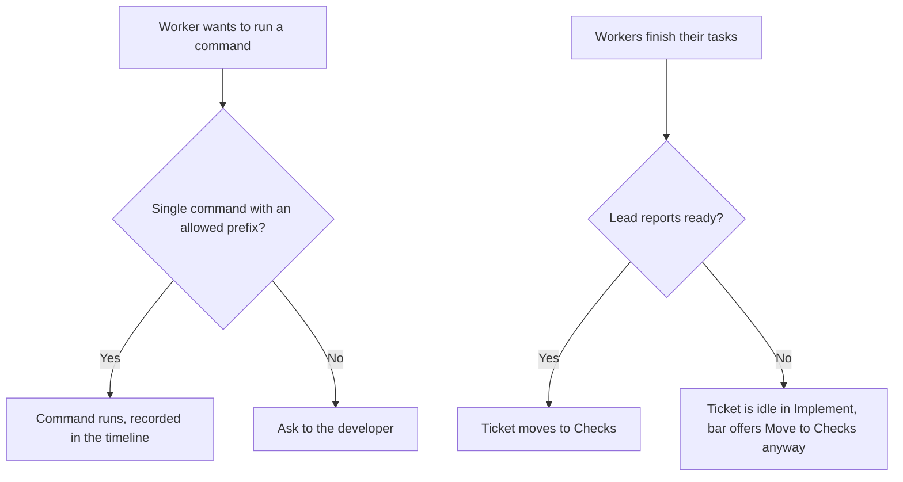

- Each worker has its own worktree, its own branch, and the allowlist of its task.
- At most four workers of one ticket run at the same time.
- The developer can stop a single task.
- A worker runs a shell command without an Ask only when the command is a single command with an allowed prefix. Each such command is recorded in the timeline.
- Every other command is an Ask to the developer.
- When the lead reports that the work is ready, the ticket moves to Checks with no action from the developer.
- If the lead stops without that report, the ticket stays in Implement as idle. The footer decision bar offers **Move to Checks anyway**.

PRD: I1, I2, I8 · P0, I8 is P1 · M3

### US-21 Answer an Ask

As the developer, I want to see the exact command and answer once, so that a blocked worker continues within seconds.

```mermaid
sequenceDiagram
	actor Dev as Developer
	participant P as pocketd
	participant W as Worker
	W->>P: Ask to run a command
	P-->>Dev: Card, Inbox row, and footer decision bar show the Ask
	Note over P: The Ask stays pending. No timeout decides.
	alt Allow once
		Dev->>P: Allow once
		P-->>W: Run the command
	else Deny
		Dev->>P: Deny, with optional feedback
		P-->>W: Do not run the command
	end
```

- The footer decision bar shows the command and the worker that asked.
- The bar offers **Deny** and **Allow once**. **Allow once** is the primary button.
- **Deny** takes optional feedback when the request accepts feedback.
- The card of the ticket and the Inbox row both show the pending Ask.
- An Ask stays pending until the developer answers. No timeout decides for the developer.

PRD: I3, I7, B8, E2 · P0 · M3

### US-22 Stop the commands that bypass a gate

As the developer, I want some commands to need my answer every time, so that an agent cannot merge or overwrite work on its own.

```mermaid
flowchart TD
	A[Agent wants to run a command] --> B{On the never-allow list?}
	B -- Yes --> C[Always an Ask to the developer]
	B -- No --> D{Allowed prefix of the task?}
	D -- Yes --> E[Command runs without an Ask]
	D -- No --> C
	F[Developer edits an allowlist at the Plan gate] --> G{Prefix on the never-allow list?}
	G -- Yes --> H[Prefix refused]
	G -- No --> I[Prefix added]
```

- These commands are always an Ask: `gh pr merge`, `gh pr review`, `gh pr create`, `git push` to the base branch, `git push --force`, and `rm -rf` outside the worktree.
- pocketd opens the PR itself. No agent needs `gh pr create`.
- The developer cannot add these prefixes to an allowlist at the Plan gate.
- A Factory session never runs with full access.

PRD: I6, E8, decision 21 · P0 · M3

### US-23 Keep slots for the tickets that work

As the developer, I want a ticket that waits on me to free its slot, so that my delay does not stop other tickets.

```mermaid
stateDiagram-v2
	state "Holds a slot" as Holds
	state "Holds no slot" as Free
	[*] --> Holds: ticket starts
	Holds --> Free: ticket reaches a gate or raises an Ask
	Free --> Holds: developer decides, even above the limit
	Holds --> [*]: ticket closes
	note right of Holds: At or above the limit, no queued ticket starts
```

- A ticket holds a slot only while it starts or works.
- A ticket that waits at a gate holds no slot. A ticket that waits on an Ask holds no slot.
- When the developer answers an Ask, the agent continues at once, even if the number of running tickets is then above the slot limit.
- While the number of running tickets is at or above the slot limit, no queued ticket starts.
- An auto-fix attempt holds the slot of its ticket. The reviewer runs in the slot of its ticket.

PRD: I5, C8, E16, §7 · P0 · M0

## Checks and auto-fix

### US-24 Run the checks without me

As the developer, I want the checks to run when the workers finish, so that I review only work that passes.

```mermaid
flowchart TD
	A[Ticket enters Checks] --> B[pocketd merges the worker branches into the ticket branch]
	B --> C{Conflict?}
	C -- Yes --> D["Failed at Checks with the list of files, no attempt counted"]
	C -- No --> E[pocketd pushes the branch and opens a draft PR]
	E --> F[pocketd runs the local check commands and watches the GitHub checks]
	F --> G{"Every local command exits 0, and no GitHub check failed or pending?"}
	G -- Yes --> H[Station passes]
	G -- No --> I[Failure goes to auto-fix]
```

- When a ticket enters Checks, pocketd merges the worker branches into the branch of the ticket, in dependency order. pocketd never touches the base branch.
- pocketd pushes the branch and opens a draft PR.
- pocketd runs the check commands of the project in the lead's checkout, and records the output and the exit code of each command.
- The station passes when every local command exits with 0 and the GitHub checks have no failed check and no pending check.
- With no local command, the GitHub checks decide. With no GitHub check, the local commands decide.
- With no check of either kind, the station passes when the draft PR exists, and the ticket says that no checks ran.
- The **Checks** tab shows each command, its real output, the attempt history, and the PR check runs.
- If the worker branches conflict, pocketd aborts the merge. The ticket shows Failed at Checks with the list of files. The conflict does not count as an auto-fix attempt.

PRD: C1, C2, C3, C4, T8, E4, decisions 7 and 17 · P0 · M4

### US-25 Let the lead fix a failure, up to the cap

As the developer, I want a failed check sent back to the lead a limited number of times, so that a ticket is repaired without me and cannot loop.

```mermaid
flowchart TD
	A[A check fails] --> B{Attempts used below the cap?}
	B -- Yes --> C[pocketd sends the failure to the lead]
	C --> D[Attempt count goes up by one]
	D --> E["Lead pushes a fix, the PR head changes"]
	E --> F{Checks pass?}
	F -- Yes --> G[Reviewer starts]
	F -- No --> B
	B -- No --> H[Ticket is Failed and stays in Checks]
```

- On a failure, pocketd sends the command, the end of the output, and the names of the failed checks to the lead.
- Each send counts as one attempt. The **Checks** tab shows the count, for example `Auto-fix 1 of 2 used`.
- The ticket shows as fixing until the head of the PR changes.
- After the last allowed attempt fails, the ticket is Failed and stays in Checks. pocketd sends no further attempt on its own.
- The attempt count survives a restart of pocketd.
- A re-run of a flaky CI check is not an attempt. A fix that produces the same head is not counted two times.

PRD: C5, C6, E6, §6.4 · P0 · M4

### US-26 Send a failed ticket back with a hint

As the developer, I want to give the lead one more attempt with my own hint, so that a blocked ticket moves only on my decision.

```mermaid
sequenceDiagram
	actor Dev as Developer
	participant B as Footer decision bar
	participant P as pocketd
	participant L as Lead
	Note over B: The ticket is Failed, Auto-fix 2 of 2 used
	alt Send back with a hint
		Dev->>B: Type a hint and send
		B->>P: factory.hint
		P->>L: One more attempt, with the hint
		L-->>P: Fix or failure
		Note over P: A failure makes the ticket Failed again
	else Close ticket
		Dev->>B: Close ticket
	end
```

- A failed ticket shows the error title, the attempt count such as `Auto-fix 2 of 2 used`, and the command output.
- The footer decision bar shows a hint field, **Send back with a hint**, and **Close ticket**.
- **Send back with a hint** is disabled while the hint field is empty.
- A hint grants exactly one more attempt. The timeline records the attempt as started by the developer.
- If that attempt fails, the ticket is Failed again. The developer can send another hint.
- The bar has no button that retries without a hint.

PRD: C7, E14 · P0 · M4

## PR review gate

### US-27 Get an independent review before I merge

As the developer, I want a second agent to read the diff, so that I start my review with findings from a different model.

```mermaid
sequenceDiagram
	actor Dev as Developer
	participant P as pocketd
	participant R as Reviewer
	participant G as GitHub
	P->>R: Start in a separate session
	R->>P: Ask to edit a file
	P-->>R: Deny
	R-->>P: Findings by severity
	P->>G: Mark the PR ready
	P-->>Dev: Ticket waits at the PR review gate, findings in the PR tab
```

- After the checks pass, pocketd starts the reviewer in a separate session.
- The reviewer uses the reviewer profile of the project. If both providers are installed, the default reviewer profile uses the provider that the lead does not use. Otherwise the reviewer uses the same provider in a new conversation.
- A profile never lifts the read-only rule of the reviewer.
- The reviewer changes no file. pocketd denies every Ask from the reviewer that edits, writes, or changes state through the shell.
- The **PR** tab lists the findings by severity: critical, minor, nit. Each finding shows the file, the line, and the message.
- A critical finding does not block the merge. The findings appear above the merge-gate rows.
- The reviewer cannot approve the PR and cannot request changes on GitHub.
- When the reviewer finishes, pocketd marks the PR ready, and the ticket waits on the developer.
- The developer can turn the reviewer off for a project.

PRD: R1, R2, R3, R4, R5, R9, T9, PF9 · P0, R9 is P1 · M5

### US-28 Merge the PR myself

As the developer, I want to be the only one who merges, so that nothing reaches the base branch without my decision.

```mermaid
flowchart TD
	A[Ticket waits at the PR review gate] --> B{Merge gate ready?}
	B -- No --> C["Merge button disabled, bar shows the reason"]
	C --> D{Conflicts with the base branch?}
	D -- Yes --> E["Resolve with agent: one auto-fix attempt, back to Checks"]
	B -- Yes --> F["Developer picks squash, merge commit, or rebase"]
	F --> G[Developer merges]
	G --> H["Ticket moves to Merged and closes, branch kept"]
```

- The footer decision bar shows **Request changes** and the merge button.
- The developer picks the merge method: squash, merge commit, or rebase.
- The merge button is enabled only when the merge gate is ready. When the button is disabled, the bar shows the reason, for example `Checks running` or `Conflicts`.
- If the PR conflicts with the base branch, the bar offers **Resolve with agent**. That action counts as one auto-fix attempt, and the ticket returns to Checks.
- After the merge, the ticket moves to Merged and closes.
- The merge never deletes the branch.
- If the PR is merged outside Anywhere, the ticket moves to Merged, and the timeline notes it.

PRD: R6, R8, E5, E10 · P0 · M5

### US-29 Request changes on the PR

As the developer, I want to send my review note to the lead, so that the same ticket carries the rework.

```mermaid
sequenceDiagram
	actor Dev as Developer
	participant B as Footer decision bar
	participant L as Lead
	participant P as pocketd
	Dev->>B: Request changes, with a note
	B->>L: Send the note
	L->>P: New head
	P->>P: Run the checks and the reviewer again
	P-->>Dev: Ticket waits at the PR review gate again
```

- **Request changes** takes a note from the developer and sends the note to the lead.
- The ticket returns to Implement, or to Checks when the lead judges the change small.
- The checks and the reviewer run again on the new head before the ticket returns to the PR review gate.

PRD: R7 · P1 · M5

## Inbox

### US-30 Clear every decision from the Inbox

As the developer, I want one list of everything that waits on me, so that I decide ticket after ticket without going back to the Board.

```mermaid
flowchart LR
	A[Inbox list] -- "J and K" --> B[Selected row]
	B --> C[Ticket on the right with the footer decision bar]
	C -- "Cmd+Enter or a button" --> D[Decision]
	D --> E[Row leaves the list]
	E --> F{Rows left?}
	F -- Yes --> B
	F -- No --> G[Nothing waiting]
```

- The Inbox has one row for each decision that waits on the developer: a plan approval, an Ask, a checks failure, and a PR review.
- The rows are in this order: tickets that wait on the developer first, then failed tickets, then the oldest first.
- A row shows the agent, the title, the type of decision, the project or the start of the command, the age, and a status dot.
- A selected row opens the ticket on the right, with the same footer decision bar as the ticket page.
- `J` and `K` move the selection. `⌘↵` triggers the primary button.
- After a decision, the row leaves the list and the next row is selected. (This criterion is from the prototype. N3 says only that the queue clears without navigation.)
- An empty Inbox shows `Nothing waiting`.

PRD: N1, N2, N3, N4 · P0, N4 is P1 · M6

## Phone

### US-31 Answer an Ask from the iPhone

As the developer away from my desk, I want to answer an Ask on the phone, so that a worker does not wait until I am back.

```mermaid
sequenceDiagram
	actor Dev as Developer
	participant Ph as iPhone
	participant P as pocketd on the Mac
	participant W as Worker
	W->>P: Ask to run a command
	P->>Ph: Push notification
	Dev->>Ph: Open the notification
	Ph-->>Dev: Permission card with the command and the worker
	Dev->>Ph: Allow once, or Deny
	Ph->>P: Answer, sent when the Mac is reachable
	P-->>W: Continue or stop
```

- A Factory Ask arrives on the phone as a push notification and as a permission card.
- The card shows the command and the worker.
- The card offers **Allow once**, and **Deny** with optional feedback.
- The session title on the phone names the ticket, for example `ANY-44 · <ticket title>`.
- A notification action alone cannot answer an Ask. The notification opens the card.
- If the Mac is asleep or the phone is offline, the Ask stays pending. The phone sends the answer when the Mac is reachable again.
- The iPhone app needs no update for v1.

PRD: PH1, PH2, PH5, E2, decisions 9 and 11 · P0 · M3

### US-32 See on the phone that a gate waits

As the developer away from my desk, I want the phone to show that a plan or a PR waits on me, so that I know to return to the Mac.

```mermaid
flowchart LR
	A[Ticket reaches the Plan gate or the PR review gate] --> B[Phone shows the session as needing the developer]
	B --> C[Phone offers no approve button and no merge button]
	C --> D[Developer decides on the Mac]
```

- A ticket at the Plan gate or at the PR review gate shows on the phone as needing the developer, in the session list and in Up next.
- The phone offers no button to approve a plan and no button to merge.
- The phone cannot edit the Factory configuration and cannot edit the Board.

PRD: PH3, PH4 · P0 · M3

## Factory configuration

### US-33 Turn the Factory on for a project

As the developer, I want the Factory to be a choice for each project, so that the other projects keep the current behaviour.

```mermaid
flowchart TD
	A[Developer turns the Factory on for a project] --> B{"gh installed and signed in?"}
	B -- No --> X["Factory stays off, page states the reason"]
	B -- Yes --> C{Project has a GitHub remote?}
	C -- No --> X
	C -- Yes --> D[Factory on for this project]
	E[Factory off] --> F[Tickets behave as today]
```

- The Factory is off by default for every project.
- With the Factory off, the tickets of the project behave as they do today.
- If `gh` is missing or signed out, or the project has no GitHub remote, the developer cannot turn the Factory on. The configuration page states the reason.

PRD: §5.10 Enabled, C9, E12, E17 · P0 · M0

### US-34 Set up the pipeline of a project

As the developer, I want each setting to save as I change it, so that the configuration never has unsaved changes.

```mermaid
sequenceDiagram
	actor Dev as Developer
	participant S as Factory page in Settings
	participant P as pocketd
	Dev->>S: Change a setting
	S->>P: factory.config.save
	P-->>S: Saved configuration
	S-->>Dev: Summary updates, with no Save button
```

- The Factory configuration is in **Settings**, on the **Factory** page, and applies to one project.
- Every change saves at once. The page has no **Save** button and no **Reset** button.
- A summary at the top states the effect of the settings, for example `2 gates · auto-fix 2× · 4 slots`.
- The page shows the pipeline as text, with the two gates marked.
- The Spec station is on or off. The default is on.
- The Plan gate and the PR gate are on and locked.
- The developer picks a profile for the lead, for the workers, and for the reviewer. The defaults are the built-in profiles `Claude · Opus`, `Claude · Sonnet`, and `Codex`.
- The slot limit is 1 to 8 and can only lower the global Board limit.
- The number of auto-fix attempts is 0 to 2. The default is 2.
- The list of check commands is empty by default. Anywhere does not detect commands.
- The reviewer is on or off. The default is on.

PRD: §5.10, G6, PF6, decisions 4, 7, 15, 16, and 18 · P0 · M6

## Guarantees

### US-35 Be the only one who can advance a gate

As the developer, I want no agent to hold a decision, so that every approval and every merge is mine.

```mermaid
flowchart LR
	Dev[Developer] --> A[Approve a plan]
	Dev --> B[Answer an Ask]
	Dev --> C[Merge a PR]
	Dev --> D[Send a hint]
	Ag[Agent in a terminal] --> R[Read Factory state]
	Rev[Reviewer] --> R
	Ag -. refused .-> A
	Rev -. refused .-> C
```

- Only the developer can approve a plan, answer an Ask, merge a PR, and send a hint. An agent holds none of these actions.
- Only the developer's Mac can edit the Factory configuration.
- An agent in a terminal can read Factory state and cannot call any action that advances a gate.
- The reviewer cannot call any action that advances a gate.
- Nothing in the pipeline approves a plan, approves a review, or merges a PR on its own.
- An automated test proves that no terminal agent and no reviewer can reach an action that advances a gate.

PRD: §4.4, N1, R3, §9 guardrails · P0 · M0

### US-36 Keep the pipeline through a restart

As the developer, I want a restart to keep every ticket where it was, so that I lose no decision and no attempt count.

```mermaid
flowchart TD
	A[pocketd restarts] --> B[pocketd reads each live Factory ticket]
	B --> C[Station restored from the team state and the PR state]
	C --> D{Worker stopped in the restart?}
	D -- Yes --> E["Task fails, ticket shows Failed at Implement with Start again"]
	D -- No --> F[Ticket continues at its station]
	C --> G[Attempt count is unchanged]
```

- After pocketd restarts, each live Factory ticket returns to its station, from the state of its team and of its PR.
- A worker that stopped in the restart fails its task. The ticket shows Failed at Implement with **Start again**.
- When the desktop app is closed, pocketd continues, and a ticket at a gate waits.
- If the developer removes the worktree or closes the ticket, the ticket closes and its workers stop.
- A closed ticket keeps its worktree and its session, as it does today.

PRD: E1, E7, E15, §4.3, §6.4 · P0 · M2 to M5

### US-37 Read Factory state from the CLI

As the developer, I want my scripts to read where each ticket is, so that I can report on the pipeline outside the app.

```mermaid
sequenceDiagram
	participant S as Script
	participant C as anywhere CLI
	participant P as pocketd
	S->>C: Read a ticket
	C->>P: Read the Board
	P-->>C: station, gate, fix, pr
	S->>C: Approve, answer, merge, or hint
	C-->>S: No such command
```

- The `anywhere` CLI output of a ticket includes `station`, `gate`, `fix`, and `pr`.
- The CLI cannot approve a plan, answer an Ask, merge, or send a hint.

PRD: §5.11 · v1, no priority or milestone in the PRD

### US-38 Keep the Board fast with many tickets

As the developer, I want the Board to stay responsive with a large backlog, so that the Factory layout does not slow the app.

```mermaid
flowchart LR
	A[1000 tickets] --> B[Board draws only the visible cards and rows]
	B --> C["One frame costs at most 8.3ms of CPU"]
```

- With 1000 tickets, one frame of the Board costs at most 8.3ms of CPU.

PRD: §9 guardrails · must hold, no milestone in the PRD

## Metrics

### US-39 See how long tickets wait on me

As the developer, I want numbers on my own delay, so that I know whether the review queue is the bottleneck.

```mermaid
flowchart LR
	A[Ticket events on the Mac] --> B[Anywhere computes the numbers on the Mac]
	B --> C["Merged per day, time from start to a ready PR"]
	B --> D["Wait at a gate, split by Plan, PR review, and Ask"]
	B --> E["Auto-fix success and mean attempts"]
	C & D & E --> F["Top of Settings, Factory"]
```

- A strip at the top of **Settings**, on the **Factory** page, shows the tickets merged per day and the median time from start to a ready PR.
- The strip shows the median time that a ticket waits at a gate, split by Plan, PR review, and Ask.
- The strip shows the share of tickets that the lead repaired within the cap, and the mean number of attempts.
- Anywhere computes every number on the Mac. No number leaves the Mac.
- The Board shows no metrics.

PRD: §9, B9, N4 · P1 · M6

## Profiles

### US-40 Save a soul, instructions, and skills as a profile

As the developer, I want to set up an agent once and reuse that setup, so that I do not repeat the same instructions on every ticket.

```mermaid
flowchart TD
	A[Developer opens Settings, Factory, Profiles] --> B{How?}
	B -- Type --> C[Type the soul and the instructions]
	B -- Import --> D[Pick a folder or a zip file]
	B -- "Skills on the Mac" --> E[Pick skills that are already installed]
	C & D & E --> F["Preview: every file with its size, non-markdown files listed apart"]
	F --> G{Developer confirms?}
	G -- No --> H[Nothing is saved]
	G -- Yes --> I[pocketd stores a copy of the profile]
```

- **Settings**, on the **Factory** page, lists the profiles. A row shows the name, the provider and the model, and the number of skills.
- A profile has a unique name, a provider and a model, a soul, instructions, and zero or more skills. The soul and the instructions are optional.
- The developer can type the soul and the instructions, or import a folder or a `.zip` file. An imported `AGENTS.md` is read as the instructions.
- Skills come from an imported folder or `.zip` file, or from the skills already installed on the Mac. A skill is a folder with a `SKILL.md`.
- Before the save, the import shows every file with its size. Files that are not markdown are listed under "Files the agent can run".
- Nothing is saved until the developer confirms. A profile is at most 2 MB.
- pocketd keeps its own copy. A later change to the source folder does not change the profile.
- Profiles are shared by all projects.
- The built-in profiles `Claude · Opus`, `Claude · Sonnet`, and `Codex` have no soul, no instructions, and no skills. The developer cannot edit them or delete them.
- The developer cannot delete a profile that a project, a plan at the gate, or a running session uses. The refusal lists each of them.
- The phone cannot see, create, or change a profile.

PRD: PF1, PF2, PF3, PF4, PF5, PF11, PF12, E22, decisions 19 and 21 · P0, PF11 is P1 · M3, the Profiles page in M6

### US-41 Give each role and each task its own profile

As the developer, I want to pick a profile for the lead, the workers, the reviewer, and each task, so that each agent gets the setup that fits its work.

```mermaid
sequenceDiagram
	actor Dev as Developer
	participant G as Plan gate
	participant P as pocketd
	participant W as Worker
	Dev->>G: Pick a profile for task t2
	Dev->>G: Approve and start the workers
	G->>P: team.start, with the profile of each task
	P->>P: Read the profile at launch
	P->>W: Start with the soul and the instructions in the system prompt
	P->>W: Copy the skills into the worker checkout, excluded from git
	W-->>Dev: Workers tab shows the profile name
```

- The project configuration has a profile for the lead, a default profile for the workers, and a profile for the reviewer.
- At the Plan gate, the developer can change the profile of each task. The plan of the lead can suggest a profile. The developer decides.
- The worker row, the **Workers** tab, and the Activity timeline show the profile name.
- The soul and the instructions go into the system prompt of the session, the soul first. pocketd writes nothing about them to the worktree.
- pocketd copies the skills of the profile into the checkout of the session, in the folder that its CLI reads skills from.
- The copied skills never reach a commit or the PR. pocketd excludes them from git.
- If the repository already has a skill with the same folder name, the repository's copy stays. The Activity timeline says that the profile skill was skipped.
- A session reads its profile when it starts. A change to the profile affects only sessions that start later.

PRD: PF6, PF7, PF8, PF10, E18, E19, decision 18 · P0 · M3

### US-42 Keep the Factory rules above any profile

As the developer, I want no profile to loosen the Factory rules, so that a soul, instructions, or a skill cannot merge, skip a gate, or open a PR.

```mermaid
flowchart TD
	A["Soul, instructions, or a skill tells the agent to run a command"] --> B{On the never-allow list?}
	B -- Yes --> C[Ask to the developer]
	B -- No --> D{Allowed prefix of the task?}
	D -- Yes --> E[Command runs]
	D -- No --> C
	F[Profile tells the agent to skip a gate] --> G[No effect: only pocketd moves a ticket through a gate]
```

- Each station prompt from pocketd states the Factory rules, and states that they override the profile.
- No profile changes a gate, the never-allow list, the read-only rule of the reviewer, the access level, or the slot rules. pocketd enforces each of them.
- Factory does not judge a skill by its name or its text. The never-allow list guards the commands that a skill tries to run.
- If a profile tells an agent to merge, to push to the base branch, or to open a PR, the command is an Ask.
- If the lead and the reviewer share a checkout and a provider, each can see the skills of the other. v1 accepts this.

PRD: PF9, I6, E20, E21, decisions 20 and 21 · P0 · M3

## Not in v1

The PRD defers these to M7. They have no story yet.

- Approve a plan and merge a PR from the phone, a ticket list on the phone, and lock-screen actions (PH6).
- **Always allow on this task** for an Ask (I4).
- A read-only access mode that the system enforces for the reviewer (R2).
- Skip the reviewer for a label (R9).
- A global cap on the number of workers (§7).
- Start a ticket from a label, a CI failure, or a review comment (N2).

## Coverage

| PRD section | Requirements | Stories |
|---|---|---|
| 5.1 Board | B1 to B15 | US-01 to US-09 |
| 5.2 Ticket detail | T1 to T10 | US-10 to US-14, US-24, US-27 |
| 5.3 Spec station | S1 to S5 | US-14 to US-16 |
| 5.4 Plan gate | P1 to P6 | US-17 to US-19 |
| 5.5 Implement and Ask | I1 to I3, I5 to I8 | US-20 to US-23 |
| 5.6 Checks and auto-fix | C1 to C9 | US-23 to US-26, US-33 |
| 5.7 PR review gate | R1 to R9 | US-27 to US-29 |
| 5.8 Inbox | N1 to N4 | US-30 |
| 5.9 Phone | PH1 to PH5 | US-31, US-32 |
| 5.10 Factory config | all settings | US-33, US-34 |
| 5.11 Scriptable surface | CLI fields | US-37 |
| 5.12 Profiles | PF1 to PF12 | US-17, US-27, US-34, US-40 to US-42 |
| 4.4 Who may do what | scopes | US-35 |
| 8 Edge cases | E1 to E22 | US-05, US-16, US-17, US-21, US-22, US-23, US-24, US-25, US-26, US-28, US-31, US-33, US-36, US-40, US-41, US-42 |
| 9 Success metrics | metrics and guardrails | US-35, US-38, US-39 |

Not covered: T11 (the static status strip under the title, P2) and E11 (two tickets that touch the same files, no behaviour in v1).
