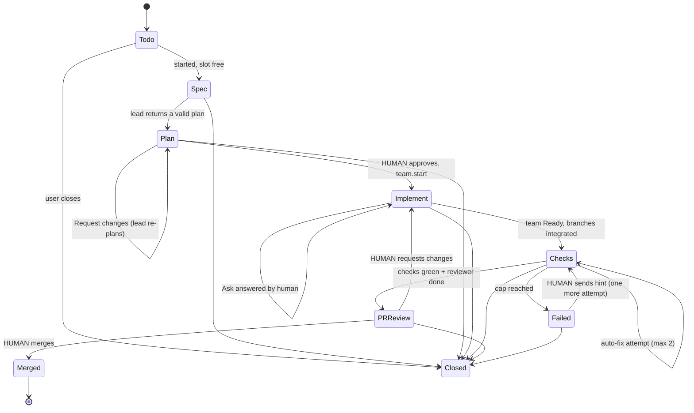

# PRD: Light Factory

| | |
|---|---|
| Product | Anywhere (v0.1.37 read) |
| Feature | Light Factory: a third Board layout that runs tickets through a gated agent pipeline |
| Status | Draft v3: adds worker profiles (§5.12, decisions 18–21) |
| Date | 2026-11-12 |
| Audience | Claude Code (implementer), the owner (reviewer) |
| User stories | `docs/designs/2026-11-12-light-factory-stories.md` |
| Prototype | `.ui-review/prototypes/light-factory/index.html` |
| Plans | `docs/plans/2026-11-12-light-factory.md` |

**Legend.** Every non-trivial claim carries a tag.
- **[R]** Read in the repo (file cited, relative to repo root; `pd` = `packages/pocketd/internal`, `pk` = `packages/desktop/crates/pocket/src`, `proto` = `pd/proto`).
- **[D]** Decided by the owner in the design thread.
- **[I]** Inferred or proposed by me.
- **[D-auto]** Decided by the assistant on the owner's behalf, to keep v1 small. Reversible; see §14 and the "Revisit later" list. Every open point was resolved in §14 as **[D-auto]**.

---

## 1. Summary and problem

Anywhere already runs many Claude Code and Codex agents, with a Board of tickets [R: `proto/ticket.go`], Team mode (lead plus workers in worktrees) [R: `docs/plans/2026-11-05-team-mode.md`], a `gh`-based PR loop [R: `docs/plans/2026-10-09-github-pr-loop.md`] and an Inbox [R: `pk/inbox/`]. Today the user stitches these together by hand: start a ticket, notice it needs something, open Team, merge, open the PR panel, send failing checks back to the agent, merge.

**Light Factory** turns those parts into one visible line. A ticket moves through stations: **To do → Spec → Plan (human gate) → Implement → Checks → PR review (human gate) → Merged**. Agents do the work between gates. The human decides at the gates and answers permission asks. *Light* means a human approves; a *dark* factory (no human review) is explicitly not built [D].

The hard rule is already in the repo and does not change: **"The human approves. Agents never hold `approve`."** [R: `docs/orchestrators/product/00-prd.md` principle 10; `docs/designs/2026-09-30-no-self-approval.md`]

**Problem statement.** The review queue, not agent throughput, is the bottleneck. The user needs to see at a glance *where they are blocking the line* and clear it in as few steps as possible, from the Mac or the phone.

## 2. Goals and non-goals

### Goals
- G1. One screen that shows every ticket's station and which tickets wait on the user.
- G2. Two human gates (Plan, PR review) plus Ask answers, each decided from one footer decision bar.
- G3. Bounded automation between gates: workers in parallel worktrees, checks, auto-fix capped at 2 attempts.
- G4. An independent, read-only reviewer agent before the PR gate.
- G5. Answer asks from the iPhone with no new wire types (phone gates come later, M7).
- G6. Per-project config that autosaves.
- G7. Linear/Notion-level information density without decorative UI (see §11).
- G8. Shape each agent with a reusable **profile**: a soul, instructions and skills, picked per role and per task (§5.12).

### Non-goals (v1)
- N1. No auto-approve, auto-merge or "autoapprover" of any kind [D].
- N2. No new triggers. A ticket enters the factory only when the user starts it (composer, card, CLI). No label rule, CI-fail or review-comment trigger. Automations stay schedule-only [R: `CONTEXT.md` Automation; `pk/automations/trigger.rs`] [D-auto, Q10].
- N3. No change to the existing Status and List board layouts, other than sharing filters.
- N4. No cloud, no telemetry. Metrics are computed and shown locally [R: PRD principle 9 "Local only. No telemetry"].
- N5. No multi-user or multi-Mac boards. No phone-side board, plan approval or merge in v1 (needs TS/Swift types; M7) [D-auto, Q9, Q11]. The phone also lacks the `own` scope [R: `devices/devices.go` PhoneScopes].
- N7. No global worker cap, per-label reviewer skip, `readonly` access mode, or "Always allow on this task" in v1 [D-auto, §14].
- N6. No Windows/Linux-specific work beyond what the desktop crate already shares [I].

## 3. Users

- **Primary: the solo developer** who runs 3–8 agent tickets in parallel on one Mac and reviews all output.
- **Secondary: the same person away from the desk** answering an ask or approving from the iPhone over Tailscale [R: README].
- **Not a user:** an agent. Agents may *read* factory state (CLI, `observe` scope) but never decide anything.

## 4. Core concepts and state machine

### 4.1 Vocabulary (to add to `CONTEXT.md` in M0)
`Run` is reserved for an Automation firing [R: `CONTEXT.md`]; never use it for pipeline progress.

| Term | Meaning |
|---|---|
| **Factory** | A Board layout (Factory / Status / List), and the per-project pipeline it renders. [D] |
| **Station** | One step of the line. A ticket is in exactly one. |
| **Gate** | A station where only the human advances the ticket: **Plan** and **PR review**. |
| **Ask** | A permission request from an agent (`permission.request`), such as "run `cargo test -p daemon`" [R: `proto/proto.go` PermissionRequest]. Not a gate. |
| **Auto-fix** | A bounded attempt, by the ticket's lead, to repair failed checks. Max 2 per ticket. [D] The lead fixes in its integrated checkout [D-auto, Q6]. |
| **Reviewer** | An independent, read-only agent that comments on the PR before the PR gate. [D] |
| **Slot** | One concurrently active ticket under the limit (unchanged meaning: a ticket, not a worker). [R: `Ticket.HoldsSlot`] [D-auto, Q3] |
| **Profile** | A named, reusable setup for one agent session: provider and model, a **soul** (who the agent is), **instructions** (how it works), and **skills**. Shared by all projects. [D, decisions 18–21] |

### 4.2 Relationship to what exists
| Factory concept | Built on | Status |
|---|---|---|
| Ticket, Board, queue, slot limit 1–8 default 4, own worktree per ticket | `proto/ticket.go`, `pd/board/scheduler.go` | [R] exists |
| Plan gate | Team `proposed` state: valid plan waiting for **Start**; the lead reads `needsYou` via `Agent.SetAwaiting` | [R] `team/teams.go:269` |
| Implement (2–4 parallel workers, own worktree and branch, per-task allowlist) | Team `running`; `team.Parallel = 4` | [R] |
| Worker asks outside allowlist go to the user | Team mode | [R] |
| PR open, checks, review state, merge gate, send failure to agent | `gh.*` verbs and `Pr.gate()` | [R] `proto/gh.go`, `desktop/crates/git/src/github.rs` |
| Ticket closes when its PR merges | `Scheduler.closeMerged` | [R] `board/scheduler.go` |
| **Ticket → Team link** | Tickets start a plain session today (`board.Spec`); Implement starts a Team led by the ticket's session | **new** [D-auto, Q2] |
| Spec station, Reviewer, Auto-fix loop, Factory layout, Factory config | none | **new** |

### 4.3 Ticket pipeline

Existing `Ticket.State` (`todo | queued | live | closed`) and `Ticket.Status` (`starting | working | needsYou | done | failed | stopped | idle`) stay as they are [R]. Factory adds `Station` and `Gate` fields, **owned and written by pocketd only** [I].



Notes:
- **Todo / Queued.** A ticket waits in `todo`; "started" (the only trigger in v1 [D-auto, Q10]) puts it in `queued` until a slot is free (existing behavior) [R]. The factory shows `queued` inside To do (count only) [I].
- **Spec.** The ticket's *lead* (one chat session for the whole ticket, read-only by prompt, in the ticket's worktree) reads the code and writes a spec: brief + acceptance criteria [D-auto, Q1].
- **Plan.** pocketd sends the lead a team prompt (`team: true`) containing the spec. A valid plan block puts the team in `proposed`; that is the Plan gate [R: team plan flow] [D-auto, Q1: same session, second turn].
- **Implement.** Human clicks Start (`team.start`; the Plan gate is always on in v1 [D-auto, Q16]). Workers run in parallel worktrees [R]. Handbacks go to the lead [R]. When the lead says "Ready to merge" the team is `ready` [R].
- **Checks.** pocketd integrates worker branches into the lead checkout (`team.merge` semantics, `--no-ff`, dependency order [R]), pushes the branch, opens a **draft** PR (`gh.pr.create`, `draft: true` [R: verb supports draft]), then runs the project's local check commands (if any) and watches GitHub checks [D-auto, Q7]. The integration merge is done by pocketd on the already-approved plan, inside the ticket's own branch; it is mechanical, not an approval, and never touches the base branch [D-auto, Q17].
- **PR review.** Reviewer comments, PR is marked ready (`gh.pr.ready` [R]), the ticket waits on the human.
- **Merged.** Human merges (`gh.pr.merge`, squash/merge/rebase [R]). pocketd closes the ticket with `ClosedWhy = merged` [R].
- **Closed** keeps worktree and session, exactly as today [R: CONTEXT.md Ticket].

### 4.4 Who may do what (the invariant)

| Action | Wire verb | Scope needed | Held by |
|---|---|---|---|
| Approve plan / start workers | `team.start` | `spawn` [R] | owner Mac, paired phone |
| Answer an Ask | `permission.resolve` | `approve` [R] | owner Mac, paired phone |
| Merge the PR | `gh.pr.merge` | `drive` [R] | owner Mac, paired phone |
| Request changes / send hint | `agent.prompt`, `factory.hint` (new) | `drive` | owner Mac, paired phone |
| Edit factory config | `factory.config.save` (new) | `own` [I, mirrors `board.*`] | owner Mac only |
| Create, edit or delete a profile | `factory.profile.save`, `factory.profile.delete` (new) | `own` [I] | owner Mac only |

In v1 the phone uses only the `permission.resolve` row; plan approval and merge from the phone ship in M7 [D-auto, Q9]. The integration merge of worker branches into the ticket's branch is performed by pocketd itself through the existing team-merge code path (no wire verb) [D-auto, Q17].
| Read factory state | `board`, `team.list`, `factory.*` read | `observe` | everyone, incl. agents |

An agent inside a Pocket Terminal is a PTY principal with `observe` only [R: `peer/scope.go` `PTYScopes`]. `peer.Needs` refuses any verb not listed [R: `peer/check.go`], so every new factory verb must be added there deliberately. Required test, in the style of the red-team gate [R: `no-self-approval.md` FR 03-5]: **no PTY or reviewer principal can reach any gate-advancing verb.**

## 5. Functional requirements

IDs are stable so tickets and tests can cite them. Priority: **P0** v1 blocker, **P1** v1 should, **P2** later.

### 5.1 Board (Factory layout)

Today `board::Layout` is `{Board, List}` and the "Status" board is `Layout::Board`; the pref is a bool, `store.board_list` [R: `pk/board.rs:36`, `:187`]. Factory becomes the third layout [D]; the pref becomes an enum [I].

| ID | Requirement | Pri |
|---|---|---|
| B1 | View tabs under the breadcrumb: **Factory · Status · List**. Existing layouts are unchanged. | P0 |
| B2 | Factory columns, left to right: To do, Spec, Plan, Implement, Checks, PR review, Merged. **To do and Merged are 44px rails** (name rotated, count). The five middle columns are 196–248px with a 12px gap. | P0 |
| B3 | At 1280px window width, with the sidebar collapsed to its 48px rail, all seven columns fit with **no horizontal scroll**. If space runs out, the sidebar collapses; a working station is never hidden. | P0 |
| B4 | Plan and PR review headers carry a quiet "You" marker, indicating who decides there. Card count is shown per column. | P1 |
| B5 | Card, four rows, the Board card of the app [R: `pocket/src/board/card.rs`]: **(1)** ID in mono and the agent avatar; **(2)** status glyph and title, max two lines, weight 500; **(3)** one note line (B6–B8); **(4)** priority icon, label chips, project, pills (sub-tasks `2/3`, branch or PR in mono). No fixed height: a card is as tall as its rows. | P0 |
| B6 | A needs-you card shows the amber needs-you glyph and one amber note: `Plan ready · 3 tasks`, `Ask · 1/2`, `Ready to merge · #203` [R: `WAITING_DOT`, `WAITING_TEXT`]. No side border, no fill, no progress bar [D]. | P0 |
| B7 | A failed card shows the red closed glyph and a red note starting with "Failed" [R: `FAILED`, `FAILED_TEXT`]. No red border, red fill or red underline. | P0 |
| B8 | A card with a pending Ask shows one muted mono line `Ask · cargo test -p daemon`. The decision lives only in the footer bar of the ticket (§5.3). | P0 |
| B9 | Filter bar, second row: `waiting on you`, `ask`, `failed` as filter chips with muted counts (accent only on the active "waiting on you" chip), slots as `3/4 slots` text, then Project, Label, Agent, Priority, and a Display control. The Board has no metrics strip; metrics live at the top of Settings → Factory (§9) [R: critique fix 11]. | P0 |
| B10 | `Search` with a `⌘K` keycap opens a command menu with Issues / Board / Docs tabs. | P1 |
| B11 | Status and List layouts group by station (foldable header: glyph, name, count, `+`; rows 36px, one line, same metadata as B5) when the Factory is enabled for that project. | P1 |
| B12 | Hidden-column tray (as in the existing Board `hidden_columns.rs` [R]) lets the user hide a station without breaking order. | P2 |
| B13 | Column order is fixed; urgency never reorders columns [R: PRD principle 8]. Within a column, order is by Up next rank: needs-you, then failed, then oldest first [R: `CONTEXT.md` Up next]. | P0 |
| B14 | Sidebar: expanded 212–280px, collapsible to a 48px icon rail (chevron, and `]`). Nav rows 32–36px with muted counts: Inbox, Waiting on you, Board, Automations; Projects with ticket counts; Agents group. There is **no separate Factory nav item**: Factory is a layout tab on the Board, and its config lives in Settings → Factory [D-auto, Q14]. Active nav row is a raised surface with a hairline, not an accent fill. | P1 |
| B15 | `+ New ticket` is a secondary button. The existing composer and keyboard flow stay [R: CHANGELOG 0.1.37]. | P0 |

### 5.2 Ticket detail (per station)

Reuses the existing ticket page [R: `pk/board/ticket_page.rs`] and adds station-aware content.

| ID | Requirement | Pri |
|---|---|---|
| T1 | Header: breadcrumb `Anywhere / Board / ANY-44`, title (24/28, weight 500–600, the only 600 on screen), one status line (`Plan · waiting for you`). | P0 |
| T2 | Layout: main column (tabs + timeline) and a **Properties** panel on the right (280–360px) with rows: Project, ID, Type, Priority, Assignee (You), Agent, Labels, Branch, PR, created/updated. Empty values are verbs (`Add label`). Labels remain the fixed set Bug, Feature, Docs, Infra [R: `proto.TicketLabels`]. | P0 |
| T3 | **Sub-issues** on every ticket: the plan tasks as rows (state mark, title, agent, branch, status; `2/3`). Source: `Team.Tasks` [R]. | P0 |
| T4 | **Activity**: typed timeline grouped by station: actor avatar, verb, relative time, structured parts (handback with `git diff --stat`, auto-allowed notice [R: team mode], check result, reviewer finding). Comment composer at the bottom (`Leave a comment`); a comment is sent to the lead as a note (`agent.prompt`) [I]. | P1 |
| T5 | Tabs, default follows the station: Plan → **Spec & plan**; Implement → **Workers**; Checks → **Checks**; PR review → **PR**. | P0 |
| T6 | **Spec & plan** is a document, not a card: title, byline (`Spec · Claude · 14:02`), brief, acceptance-criteria checklist, then the plan as sub-issues. File paths are inline mono, not bordered chips. | P0 |
| T7 | **Workers** tab: each worker row with state, branch, diff stat, last summary. | P0 |
| T8 | **Checks** tab: the command, the real output in mono (never red-tinted), attempt history (`Auto-fix 1 of 2 used`), PR check runs list [R: `CheckRun`]. | P0 |
| T9 | **PR** tab: PR title/number, merge-gate rows from `Pr.gate()` [R], reviewer findings by severity (critical / minor / nit), diff entry. | P0 |
| T10 | A single **sticky footer decision bar** is the only place a decision is made; its primary button is the only filled-accent element on the screen (§5.3–5.7). | P0 |
| T11 | Status glyph strip under the title is static, no animation. | P2 |

### 5.3 Spec station

| ID | Requirement | Pri |
|---|---|---|
| S1 | On start, pocketd creates the ticket's worktree (existing `board.Spec` path [R]) and a **chat** session as the lead [I: team prompts require `chat: true` [R]]. The same session is the lead for Plan and Implement and for auto-fix [D-auto, Q1, Q6]. | P0 |
| S2 | First turn: prompt asks for a spec (brief, acceptance criteria, risks) and forbids edits, following the team rules block style ("Don't edit files or run anything that changes them") [R: `team.Wrap` text]. Output is parsed from a fenced block, like `<anywhere_team_plan>` [R], e.g. `<anywhere_factory_spec>` [I]. | P0 |
| S3 | The spec is stored by pocketd (`state/factory/<ticket>/spec.md`), not committed into the worktree [D-auto, Q12]. | P0 |
| S4 | If no valid spec after one repair turn, the ticket shows Failed with the reason (mirrors the team repair behavior [R: `team.Repair`]). | P0 |
| S5 | Spec may be disabled per project; the lead then skips turn 1 and goes straight to a team prompt built from the ticket's own prompt [I]. | P1 |

### 5.4 Plan gate

| ID | Requirement | Pri |
|---|---|---|
| P1 | Plan station = Team `proposed`. pocketd marks the lead awaiting the user so it reads `needsYou` everywhere: sidebar, Dock badge, phone [R: `Teams.change` → `SetAwaiting`]. | P0 |
| P2 | The gate shows the existing plan edits: remove a task (blocked if another kept task depends on it), change the task's **profile** (which carries its provider and model, §5.12), edit allowlist. Titles, instructions and `after` are fixed [R: `pk/team/plan.rs`]. | P0 |
| P3 | Footer bar: **`Request changes`** (secondary) and **`Approve and start N workers`** with a `⌘↵` keycap (primary). Copy: "Only you can start the workers. Agents can't approve their own plan." No sparkle icon [D]. | P0 |
| P4 | Approve calls `team.start` with the kept `TaskPick`s [R]. | P0 |
| P5 | Request changes sends a team prompt to the lead; allowed while the team is `proposed` [R: "replaces … when proposed"]. Body = the user's note. | P0 |
| P6 | The Plan gate **cannot be disabled** in v1, like the PR gate. A pre-authorised config would put approval in a setting rather than a human decision [D-auto, Q16]. | P0 |

### 5.5 Implement and Ask

| ID | Requirement | Pri |
|---|---|---|
| I1 | While Implement runs, workers behave exactly as Team mode [R]: own worktree and branch, allowlist per task, handbacks, `team.Parallel = 4`, Stop per task. | P0 |
| I2 | A shell Ask passes through the allowlist rule: auto-allowed only for a single command with an allowed prefix (no `;`, `&&`, `||`, `|`, `&`, `` ` ``, `$(`, `>`, `<`, newline) [R: team-mode.md]; each auto-allow is recorded in the timeline. Everything else is an Ask to the user. | P0 |
| I3 | **Ask UI.** Footer bar shows the command in mono, the worker, and: **`Deny`** (optional feedback, only when `feedback` is set [R: `PermissionRequest.Feedback`]) and **`Allow once`** (primary, `⌘↵`). `Allow once` = `permission.resolve{decision: allow}` [R]. | P0 |
| I4 | **Deferred (M7):** "Always allow on this task" needs a new verb because the allowlist is fixed at `team.start` [R]. In v1 the user widens an allowlist at the Plan gate (P2) or answers `Allow once` [D-auto, §14 additional decision]. | P2 |
| I5 | **Slot rule change [D]:** a ticket that is waiting on an Ask (or sitting at a gate) **does not hold a slot**. Today `HoldsSlot` counts `needsYou` [R: `proto/ticket.go`; `CONTEXT.md` Queued]. Replace by: holds a slot iff `live` and `starting` or `working`. When an Ask is answered the agent resumes immediately, even if that puts running tickets above the limit; the scheduler just stops starting queued tickets until the count is below the limit [I]. | P0 |
| I6 | **Never-allow list** for factory sessions: `gh pr merge`, `gh pr review`, `gh pr create`, `git push` to the base branch, `git push --force`, `rm -rf` outside the worktree. pocketd opens the PR itself (C2), so no agent needs `gh pr create` [D, decision 21]. These are always an Ask, never allowlisted at the Plan gate either (the plan sheet refuses those prefixes) [I]. Factory sessions are launched with access `ask` or `edits`, never `full` [R: `proto.Accesses`] [I]. | P0 |
| I7 | The ticket's Ask pointer on its board card follows B8; the inbox row follows §5.8. | P0 |
| I8 | When the lead says "Ready to merge" the team is `ready` [R] and the ticket advances to Checks automatically. If the lead does not say it, the ticket stays in Implement as `Idle` with a "Move to Checks anyway" action on the footer [I]. | P1 |

### 5.6 Checks and auto-fix

| ID | Requirement | Pri |
|---|---|---|
| C1 | On entering Checks, pocketd integrates worker branches into the lead checkout in dependency order. A conflict aborts the merge, lists files, mails the lead [R: team merge behavior]. Integration uses the already-approved plan; no extra gate [I]. | P0 |
| C2 | pocketd pushes the branch and opens a **draft PR** (`gh.pr.create`, `draft: true`, title/body from the existing commit-message agent preference, `store::prefs::Git::pr_argv` [R: PR-loop plan]) [I]. | P0 |
| C3 | Project config lists local check commands, e.g. `cargo fmt --check`, `cargo clippy`, `cargo test`, `go test ./...` (optional; empty by default, no auto-detection in v1 [D-auto, Q7]). pocketd runs them (not an agent) in the lead checkout, captures output and exit code [I]. | P0 |
| C4 | The station passes when every configured local command exits 0 **and** the PR's GitHub checks have `failed == 0 && pending == 0` [R: `Checks` struct]. With no local commands configured, GitHub checks alone decide; with no GitHub checks reported, local commands alone decide; with neither, the station passes once the draft PR exists and the user is told no checks ran [D-auto, Q7]. | P0 |
| C5 | **Auto-fix.** On failure, pocketd sends the failure output (command, tail of output, failing check names) to the **lead session** as a note, which still sits in the integrated checkout [D-auto, Q6]. The attempt counter increments per send, `Ticket.Fix` [I]. The "Fixing" state ends when the PR head changes (same rule as the existing PR loop [R: "Fixing lasts until `head_oid` changes"]). | P0 |
| C6 | **Cap = 2 attempts per ticket [D].** After the second failed attempt, the ticket is `Failed`, station stays Checks. pocketd never sends a third automatic attempt. | P0 |
| C7 | Failed callout: error title and `Auto-fix 2 of 2 used` in toned-down red; command output stays neutral mono. Footer: **`Send back with a hint`** (text field required; grants exactly one more attempt, recorded as human-initiated) and `Close ticket`. No plain "Retry" button, since a blind retry is what the cap exists to stop [I]. | P0 |
| C8 | Auto-fix attempts hold a slot while working (the ticket is `working`) [D-auto, Q6]. | P0 |
| C9 | If `gh` is missing or signed out (`gh.status`: `missing` / `signedOut` [R: `proto/gh.go`]) the Factory cannot be enabled for that project; the config shows why [I]. | P0 |

### 5.7 PR review gate

| ID | Requirement | Pri |
|---|---|---|
| R1 | After Checks pass, pocketd starts the **Reviewer**: a separate session, **read-only**, with the reviewer profile of the project (§5.12). The default reviewer profile uses the provider the lead does not use when both are installed, else the same provider with a fresh conversation [I]. It runs under the ticket's slot [D-auto, Q3, Q8]. A profile never lifts the reviewer's read-only rule (R2). | P0 |
| R2 | "Read-only" means: launched with access `ask`, prompt forbids edits, and pocketd auto-**denies** any edit/write/shell-mutating Ask from it. The repo has no read-only access mode today (`Accesses` = settings, ask, edits, auto, full [R]); a true `readonly` mode is deferred [D-auto, Q8]. | P0 |
| R3 | The reviewer returns findings in a parsed block (severity critical / minor / nit, file, line, message) [I]. pocketd shows them in the PR tab and, optionally, posts them as a PR comment (`gh.thread.reply` style, `drive` scope) [I]. **The reviewer can't approve or request changes on GitHub; nothing in the pipeline calls a review-approve API.** [D] | P0 |
| R4 | Critical findings do not auto-block the merge, they show above the merge gate. The human decides [I]. | P0 |
| R5 | When the reviewer finishes, pocketd calls `gh.pr.ready` and marks the lead awaiting the user (`SetAwaiting`) so the ticket reads `needsYou` [R pattern]. | P0 |
| R6 | Footer: **`Request changes`** and **`Squash and merge`** (primary, `⌘↵`; merge method picker: squash/merge/rebase [R: `MergeMethods`]). The merge button is enabled only when `Pr.gate()` is `Ready` [R: `desktop/crates/git/src/github.rs`]. Reflect the gate reason when disabled (`Checks running`, `Conflicts`, …). | P0 |
| R7 | Request changes sends the user's note to the lead; ticket returns to Implement (or Checks if the change is small, lead decides) and re-runs Checks and the reviewer on the next head [I]. | P1 |
| R8 | Merge never deletes the branch (`--delete-branch` is never used [R: PR-loop plan]). Worktree removal follows the existing `removal.rs` flow [R]. | P0 |
| R9 | Reviewer is on/off per project. Per-label skip is deferred [D-auto, Q8]. | P1 |

### 5.8 Inbox

The desktop Inbox exists [R: `pk/inbox/list.rs`, `detail.rs`]. Factory extends it, not replaces it.

| ID | Requirement | Pri |
|---|---|---|
| N1 | One row per decision waiting on the user: plan approval, command Ask, checks failed, PR review. Order is Up next: needs-you first, then failed, oldest first [R]. Subtitle: `Needs you first, then failed`. | P0 |
| N2 | Row: agent avatar, title, type, project or command excerpt, age, status glyph. Count in the nav is the app's amber count badge [R: `count_badge`]. | P0 |
| N3 | Split view: list on the left, the same panel and **same footer decision bar** as the ticket page on the right, so the queue can be cleared without navigating. `J`/`K` move, `⌘↵` primary. | P0 |
| N4 | Empty state is compact and structured (`Nothing waiting`), no illustration. | P1 |

### 5.9 Phone (iOS)

The iOS app has no Board and no TS/Swift ticket types today [R: grep of `packages/ios`, `packages/protocol/src`; board wire exists only in Go and Rust]. It does have `PermissionCard` (Deny, Reply, Allow once) and the `approve`, `spawn` and `drive` scopes [R: `FeatureChat/PermissionCard.swift`; `devices.PhoneScopes`]. **v1 phone scope is asks only, with zero TS/Swift wire change** [D-auto, Q9, Q11].

| ID | Requirement | Pri |
|---|---|---|
| PH1 | A factory Ask arrives as today's `permission.request` and push. The card shows the command in mono and the worker. **Allow once**; Deny with optional feedback. | P0 |
| PH2 | Ticket context without new types: pocketd sets the lead's session title to `ANY-44 · <ticket title>` (`Agent.SetTitle` [R: `agent/agent.go`]) so the phone's existing session title identifies the ticket. Verify in M3 that the provider's own title doesn't overwrite it; if it does, prefix the Ask `Detail` instead [I]. | P0 |
| PH3 | Plan and PR gates show on the phone only as the existing `needsYou` status and Up next entry (they already read `needsYou` through `SetAwaiting` [R pattern]). The phone shows the session but offers no plan or merge button; the user finishes on the Mac. | P0 |
| PH4 | The phone never edits factory config or the Board (no `own` scope). | P0 |
| PH5 | An Ask is never resolvable from a push-notification action alone; it opens the card [I]. | P0 |
| PH6 | **Later (M7):** `AgentSummary.ticket` and mirrored `Ticket` types in TS/Swift, a phone gate list, plan approval (`team.start`) and merge (`gh.pr.merge`) from the phone, lock-screen actions. | P2 |

### 5.10 Factory config (per project)

Config is per project [D] and **autosaves on change** (no Save/Reset buttons) [D]. It lives in a new store next to `board.json` (`state/factory.json`, `atomicfile`, same pattern as `board.Store`) [R pattern] [I]. Settings → "Factory" page (the only home of Factory config; no sidebar item [D-auto, Q14]), one section per topic, Linear-settings style rows (title, one-line description, control on the trailing edge) [I].

| Setting | Values | Default | Notes |
|---|---|---|---|
| Enabled | on / off | off | Off = project's tickets behave exactly as today. |
| Pipeline | text stepper `To do · Spec · Plan approval · Implement · Checks · PR review · Merged`, gates marked with a small accent dot | n/a | Read-only display. Not a row of bordered chips. |
| Spec station | on / off | on | S5 |
| Plan gate | **always on, locked** | on | [D-auto, Q16] agents never self-start; pre-authorising in config is not a human decision. |
| PR gate | **always on, locked** | on | [D] agents never merge. |
| Profile per role | lead, workers (default for each task), reviewer: a profile from §5.12 | lead `Claude · Opus`, workers `Claude · Sonnet`, reviewer `Codex` (built-in profiles) | [D, decision 18] A task can take another profile at the Plan gate (P2). |
| Slot limit | 1–8 | inherits Board limit | The Board limit is global today [R: `board.limit`, `proto.MaxBoardLimit`]; a project limit can only lower it, and the global limit still applies across projects [D-auto, Q4]. |
| Auto-fix attempts | 0–2 | 2 | Cap is 2 in v1 [D]; range 0–2 [D-auto, Q15]. |
| Check commands | list of commands | empty (GitHub checks only) | [D-auto, Q7] no auto-detection in v1 |
| Reviewer | on / off | on | R9; no per-label skip in v1 |

Pipeline summary strip at the top shows the effect live, e.g. `2 gates · auto-fix 2× · 4 slots`.

### 5.12 Profiles (soul, instructions, skills)

A profile shapes one agent session, the way Hermes Agent profiles and OpenClaw agent workspaces do: each keeps a `SOUL.md` (identity, tone, limits), working instructions (`AGENTS.md` in OpenClaw) and its own skills folder [I: see Appendix A]. Factory workers live for one task, so a profile carries no memory.

| ID | Requirement | Pri |
|---|---|---|
| PF1 | A profile has a unique name, a provider and model, a soul (markdown, optional), instructions (markdown, optional) and zero or more skills. A skill is a folder with a `SKILL.md`, as Claude and Codex read them [R: `pd/skills/skills.go`]. | P0 |
| PF2 | Profiles are **shared by all projects** [D, decision 19]. They live in pocketd state, `state/factory/profiles/<id>/` (`SOUL.md`, `INSTRUCTIONS.md`, `skills/<name>/…`), not in any repo [I]. | P0 |
| PF3 | Built-in profiles, one per installed model (`Claude · Opus`, `Claude · Sonnet`, `Codex`), have no soul, instructions or skills, so a project that never adds a profile behaves exactly as the rest of this PRD describes. Built-ins cannot be edited or deleted [I]. | P0 |
| PF4 | **Create.** Settings → Factory → Profiles. The user types the soul and the instructions, or imports a folder or a `.zip` laid out as in PF2 (`AGENTS.md` is read as instructions) [I]. Skills come from an imported folder or `.zip`, or from the skills already on the Mac (the list `skills.Scan` reads [R]). pocketd stores a **copy**; later edits to the source do not change the profile [I]. | P0 |
| PF5 | **Preview before save.** Import shows every file with its size. A file that is not markdown is listed under "Files the agent can run". Nothing is saved until the user confirms. Factory does not judge a skill by its name or text; the never-allow list (I6) guards what a skill tries to run [D, decision 21]. Size cap per profile: 2 MB [I]. | P0 |
| PF6 | **Assign** a profile to each role in the project's config: lead, workers, reviewer (§5.10). At the Plan gate the user can change the profile of each task (P2); the lead's plan may suggest one, the user decides [D, decision 18]. The worker row, the Workers tab and Activity show the profile name. | P0 |
| PF7 | **Soul and instructions** reach the agent through its system prompt: Claude `--append-system-prompt`, Codex `developer_instructions` [R: field in `pd/codex/testdata/thread_resume.json`] [I: verify the Claude launch path in M3]. Order: soul, then instructions. Nothing is written to the worktree. | P0 |
| PF8 | **Skills** are copied into the session's own checkout, where its CLI reads skills: Claude `.claude/skills/<name>/`, Codex `.agents/skills/<name>/` [R: `pd/skills/claude.go`, `skills.go`]. pocketd adds each copied path to the repo's `info/exclude` so it never reaches a commit or the PR [I]. A skill whose folder already exists in the checkout is skipped and the repo's own copy wins; Activity says so [I]. | P0 |
| PF9 | **Factory rules win.** The station prompt pocketd sends each turn (spec, plan, worker task, fix note, review) states the Factory rules and that they override the profile. No profile changes a gate, the never-allow list, the reviewer's read-only rule, the access level or the slot rules; those are enforced by pocketd, not by the prompt [D, decision 20]. | P0 |
| PF10 | pocketd reads a profile when it **starts** a session. Editing a profile changes only sessions started later; a running session keeps what it started with [I]. | P0 |
| PF11 | **Delete** is refused while a project config, a plan waiting at the gate or a live session uses the profile; the refusal lists them [I]. | P1 |
| PF12 | The phone cannot read, create or change profiles (no `own` scope [R]). Agents may list profile names (`observe`), never their contents [I]. | P0 |

### 5.11 Scriptable surface

The `anywhere` CLI reads, adds, edits and deletes tickets [R: CHANGELOG 0.1.37 #218; `pocketd/cmd/pocketd/anywhere.go`]. v1 adds read-only fields (`station`, `gate`, `fix`, `pr`) to its output. It gets **no** verb to approve, answer an Ask, merge or send a hint. [I]

## 6. Data model and protocol changes

All new wire is additive, behind a new cap, matching the repo's rule "additive protocol behind `hello.caps`" [R: PRD principle 6]. Cap: **`factory.v1`** (`proto.CapFactory`), alongside `board.v1`, `team.v1` [R: `proto/ticket.go`].

### 6.1 `proto.Ticket` additions (`pd/proto/ticket.go`) [I]
```go
Station string `json:"station,omitempty"` // spec | plan | implement | checks | pr | merged; empty = not a factory ticket
Gate    string `json:"gate,omitempty"`    // plan | pr when waiting on the human; "ask" when a worker ask is pending
Lead    string `json:"lead,omitempty"`    // agent id of the lead session; also team key (proto.Team.Lead) [D-auto, Q2]
PR      int    `json:"pr,omitempty"`      // PR number once opened
Fix     int    `json:"fix,omitempty"`     // auto-fix attempts used
Hint    bool   `json:"hint,omitempty"`    // one human-granted attempt remaining
```
`Ticket.Valid()` and `decodeTicket` use a strict allowlist of keys [R]; these fields are **server-owned** and must **not** be added to the `board.save` allowlist, so clients cannot set a station or reset a counter. The existing `AgentID` points at the lead's session [R].

### 6.2 New verbs and events [I]
| Verb | Fields | Scope | Purpose |
|---|---|---|---|
| `factory.config.get` | `id`, `project` | observe | Read per-project config |
| `factory.config.save` | `id`, `project`, `config` | **own** | Autosave write |
| `factory.hint` | `id`, `ticketId`, `text` | drive | "Send back with a hint" |
| `factory.profile.list` | `id` | observe | Profile names, provider, model, skill count (no contents) |
| `factory.profile.get` | `id`, `profile` | **own** | A profile with its soul, instructions and skill files |
| `factory.profile.save` | `id`, `profile` (files inline, PF5 cap) | **own** | Create or replace a profile |
| `factory.profile.delete` | `id`, `profile` | **own** | Refused while in use (PF11) |

Events: `factory.config` and `factory.profiles` (reply and push), and the existing `board` snapshot (never a delta [R: `proto.Board`]) now includes the new ticket fields. Every verb is added to `peer.Needs` [R] with the scope above. Gate decisions deliberately **reuse** existing verbs (§4.4), so no second approval path exists. `team.allow` is **not** added in v1 (I4). `team.start`'s `TaskPick` gains an optional `profile` field (additive) [I].

### 6.3 Mirrors
- **Go:** `pd/proto` (types, decoders, golden tests `golden_test.go`), `pd/board` (scheduler), new `pd/factory` package (pipeline engine; one writer through a `change` function like `Teams.change` [R: team-mode.md "One team engine"]).
- **Rust:** `agents::tickets` (the desktop's ticket and board model [R: `desktop/crates/agents/src/tickets.rs`]), `pk/board/` (Factory layout, columns, card), `pk/team/` (reuse plan sheet), `pk/inbox/`, settings page.
- **TS (`packages/protocol/src`) and Swift (`packages/ios/.../Wire`):** **no changes in v1** [D-auto, Q11]. The phone answers asks over existing `permission.*` messages and identifies the ticket by session title (PH2). The `factory.v1` cap is Go and Rust only; old and new clients ignore unknown ticket fields. Mirroring `Ticket` and adding `AgentSummary.ticket` belongs to M7. (Note iOS already decodes `Team` [R: `Wire/Team.swift`], which will help M7.)

### 6.4 Pipeline engine (pocketd) [I]
- New `pd/factory` package. It **owns** `Station`, `Gate`, `Fix`. It subscribes to: board changes, `team.update`, agent status, `gh` PR state (`pd/github` cache [R]).
- One goroutine, one mutex, pure decision functions: `Next(ticket, team, pr, checks) → (ticket', actions)`. Tests sit beside the logic, named as sentences [R: CLAUDE.md].
- Persistence: ticket fields in `board.json` (already atomic [R]); config in `factory.json`; spec text and profiles in `state/` (not in the repo).
- Restart recovery follows `Teams.Recover`: after `Daemon.WaitRestored`, reconcile each live factory ticket from its team state, PR state and `Fix`. `Fix` survives a restart, so a restart can't grant a third attempt [R pattern] [I].
- Gates use `Agent.SetAwaiting` on the lead; `Agent.Turn` stays the agent's own status, so keep-awake and account switches ignore the wait [R: team-mode.md].

## 7. Slots, parallelism and cost

- A slot is a ticket [R] [D-auto, Q3]. A ticket in Implement can run up to 4 workers (`team.Parallel = 4` [R]). With the default limit of 4, the worst case is 16 workers; at the maximum limit of 8 it is 32. v1 adds **no global worker cap**; the user controls load with the slot limit. Revisit if it hurts (see "Revisit later").
- Ticket waiting on an Ask or at a gate: no slot (I5). Auto-fix attempt: slot (C8).
- Reviewer: one extra session per PR, run under the ticket's slot, not a second slot [D-auto, Q8].
- Project slot limit ≤ global limit; the scheduler enforces both when claiming [D-auto, Q4].

## 8. Edge cases

| # | Case | Behavior |
|---|---|---|
| E1 | pocketd restarts mid-pipeline | Recover per §6.4; a worker that is gone fails its task (`the worker stopped when pocketd restarted`) [R: team recovery]; ticket shows Failed at Implement with Start again [R: Relaunch]. |
| E2 | Mac sleeps or the phone is offline while an Ask is pending | The ask stays pending; the phone's answer is queued until the Mac is back [R: `PermissionCard` offline comment]. No timeout auto-decision. |
| E3 | Plan task conflicts (two tasks share a file) | Prevented by plan validation `team.Validate` [R]; if it fails twice the ticket Fails at Plan with the reason [R: repair once]. |
| E4 | Merge conflict when integrating worker branches | Stop, abort merge, list files, mail lead [R]. Counts as an auto-fix attempt? **No.** Goes to Failed at Checks with the conflict list for a human hint [I]. |
| E5 | PR conflicts with base after the gate opens | `Pr.gate() == Conflicts` disables merge [R]; footer offers "Resolve with agent" (existing PR-loop prompt: merge origin/base and resolve [R]). Counts as one auto-fix attempt and the ticket returns to Checks [I]. |
| E6 | CI flakes | A re-run is not an attempt. A fix attempt that produces an identical head hash is not counted twice [I]. |
| E7 | User removes the worktree or closes the ticket during the pipeline | Existing sweep closes the ticket, `ClosedWhy = deleted` [R]. Spawned workers stop via `team.stop`. |
| E8 | An agent runs `gh pr merge` itself in its shell | I6 never-allow list makes it an Ask the user denies. Also recommend branch protection on the base branch. A full-access session could bypass this; the Factory doesn't launch those. Residual risk, documented (Revisit later). |
| E9 | The user edits the plan and removes a dependency target | Blocked by the sheet (`removable`) [R]. |
| E10 | The user manually merges the PR on github.com (or an agent did, E8) | `closeMerged` polling closes the ticket [R: 5 min cadence `mergedEvery`]; the Factory moves it to Merged and notes "Merged outside Anywhere" in Activity [I]. |
| E11 | Two tickets touch the same files | Both run, conflicts surface at integration/PR. No cross-ticket locking in v1 [I]. |
| E12 | Project has no GitHub remote | Factory can't be enabled (C9). |
| E13 | Spec agent says the work is trivial | Spec can be switched off in config; the Plan gate can't. The agent can't skip a gate [D] [D-auto, Q16]. |
| E14 | Auto-fix cap reached, human sends hint, fails again | Ticket returns to Failed; each hint grants exactly one attempt; unlimited hints are allowed because each is a human action [I]. |
| E16 | Ask answered while the board is at or above its limit | The agent resumes at once; no new queued ticket starts until the running count is below the limit [D, I5]. |
| E17 | A ticket is started on a project with Factory disabled | Behaves exactly as today (plain session, existing columns) [R]. |
| E18 | A profile is edited while sessions that use it run | Running sessions keep the version they started with; new sessions take the edit (PF10). |
| E19 | A profile skill has the same folder name as a skill the repo already has | The repo's copy stays; the profile's is skipped and Activity notes it (PF8). |
| E20 | A profile's soul or instructions tell the agent to merge, skip a gate or push to base | Nothing changes: gates are pocketd actions and the never-allow list still makes those commands an Ask (PF9, I6). |
| E21 | The lead and the reviewer share a checkout and use the same provider | Each can see the other's profile skills in that checkout [I]. Accepted in v1; see Revisit later. |
| E22 | The user deletes a profile that a project or a waiting plan uses | Refused, with the list of users (PF11). |
| E15 | Desktop closed | pocketd keeps running; Plan/PR gates wait [R: "daemon owns the terminals"]. |

## 9. Success metrics

All local, shown in a quiet strip at the top of Settings → Factory; nothing leaves the Mac [R: no telemetry]. The Board shows no metrics.

**Primary**
- Tickets merged per day, and **median time from start to PR-ready** (draft→ready).
- **Median time a ticket waits at a gate** (human latency), split by Plan / PR / Ask.

**Quality**
- % of tickets that reach PR review with no human action *outside* a gate or Ask.
- Auto-fix success rate (fixed within the cap) and mean attempts.
- Plan "Request changes" rate; PR "Request changes" rate.
- Reviewer findings later acted on (a commit after the finding touches the file).

**Guardrails (must hold)**
- **0** gate-advancing verbs accepted from a PTY or reviewer principal (automated test).
- **0** merges not preceded by a human `gh.pr.merge`.
- Board stays at one frame ≤ 8.3ms CPU with 1000 tickets (virtualization, per CLAUDE.md "Desktop performance") [R].

## 10. Rollout and milestones

Each milestone is one or more PRs; each ships dark behind `Factory enabled = off` per project. Desktop code follows ADR 0003 and CLAUDE.md (model crates hold logic; `pocket` holds views; one module per feature; tests beside logic; capture screens before and after with `.ui-review/fixture/capture.sh`) [R].

| M | Scope | Exit criteria |
|---|---|---|
| **M0** Foundations | `CONTEXT.md` terms (Factory, Station, Gate, Ask, Auto-fix, Reviewer; no "Line"); ADR; `factory.v1` cap; `Ticket` fields; per-project config store; **slot rule change** (I5) with tests; project slot limit in `Claim` (lowers the global limit only); verb allowlist entries and the "no PTY can advance a gate" test. | Existing board behavior unchanged when disabled; scheduler tests cover over-limit resume. |
| **M1** Factory layout (read-only) | Third layout, fixed columns, rails, density (B1–B15, T1–T3, T5 shell), sidebar collapse, filters, Properties panel. Stations **derived** from existing ticket/team data so it renders real tickets. | At 1280px all seven columns fit; capture screens match the design shots. |
| **M2** Spec + Plan gate | Lead session, spec block, team prompt, Plan footer bar, Request changes, Approve → `team.start`. | A ticket goes To do → Plan → Implement on a test repo. |
| **M3** Implement + Ask + Profiles | Ticket → Team link (`Ticket.Lead`, Implement = `team.start`), Ask footer bar (`Allow once`, `Deny`), never-allow list, session title `ANY-44 · title` for phone context, phone ask card works unchanged. Profile store, built-ins, injection of soul, instructions and skills at launch, profile per task at the Plan gate (PF1–PF3, PF6–PF10). | Ask answered from the phone with no TS/Swift change; slots freed while waiting. A worker started with a profile has its soul and instructions in its system prompt and its skills in its checkout, and none of them appear in the PR diff. |
| **M4** Checks + auto-fix | Integration, draft PR, local checks, GitHub checks, auto-fix ×2, Failed callout, `factory.hint`. | Forced failing test is retried twice, then Failed; hint grants one more. |
| **M5** Reviewer + PR gate | Reviewer session, findings block, `gh.pr.ready`, merge footer, Merged rail. | Full ticket merges end to end; reviewer cannot edit or approve (tested). |
| **M6** Inbox, config, polish | Inbox extension, Settings → Factory page (autosave), Profiles page with import and preview (PF4, PF5, PF11), `⌘K` menu, grouped Status/List, metrics strip at the top of Settings → Factory, docs. | Config autosaves with no Save button; Inbox clears a queue with `J/K/⌘↵`. |
| **M7** Later (not v1) | Phone board and gates: mirror `Ticket` and `AgentSummary.ticket` in TS/Swift, phone plan approval and merge, lock-screen actions; `team.allow` ("Always allow on this task"); `readonly` access mode; per-label reviewer skip; global worker cap if needed. | Each is its own PR, decided after dogfooding. |

Release gating: dogfood on Anywhere's own repo for one week before announcing in the changelog [I].

## 11. Design principles (anti-slop rules)

Source: the unslop audit and Critiquito's critique, and the owner's explicit feedback [D]. These are acceptance criteria for every UI PR.

**Hard rules [D]**
1. **No colored side-border accents.** No left or right colored edge on cards, inbox rows, banners or gates. Needs-you is shown by the amber needs-you glyph and one amber note.
2. **No sparkle or magic-wand icons.** Primary gate buttons carry a `⌘↵` keycap.
3. **Status and labels follow the app.** Status is the coloured status glyph of the Board [R: `status_glyph`]; a label is a chip with a small coloured dot [R: `label_dot`]. No other coloured pills.
4. **The app's status colours, no new ones.** Needs-you amber (`WAITING_DOT`, `WAITING_TEXT`), working orange, failed red, success green, in review blue, merged violet. The gate primary button is the app's graphite primary. Factory adds no colour token.

**Further rules [from the audit]**
5. One graphite ramp (dark: `#0f0f10` sidebar, `#141415` page, `#19191b` card, `#232325` raised; light: `#fafafa`, `#f4f4f5`, `#ffffff`); hairline = primary text at 8%. Three text roles (primary, secondary, muted).
6. Merged uses the app's merged glyph and the violet merge icon (`MERGED`), with `Merged · #201 · +96 -4`.
7. Agent avatars are the app's 18px avatar with the provider icon [R: `agent_avatar`]. No project letter tiles on cards.
8. No progress underlines on cards. Failed = red glyph + red note; failed check callout = 20% red hairline, 8% tint, red only on the error title and `Auto-fix 2 of 2 used`, compiler output neutral.
9. Type: one UI face plus one mono (Geist / Geist Mono; the desktop's existing Geist Mono stays [R: theme.rs]). Weights 400 and 500; 600 only for the detail title and the count badge. **Work-order mono** for IDs, branches, paths, commands, diffs and check output. No uppercase tracked labels, no italics.
10. Spacing on a 4px grid; the same padding and row height within any list.
11. Short strings have no trailing period; search placeholder is `Search`; no exclamation marks, hype words, greetings or "AI" badges. Gate buttons stay plain and specific.
12. No boxes in boxes: no bordered file-path chips; the pipeline is a text stepper.
13. Radius follows size (controls 8–10, cards 12–14, panels 14–16). Not everything is a pill.
14. Motion: no looping pulse or shimmer, no `hover:scale`; hover is a surface step; one easing curve; state dots are static.
15. Density without decoration: richness comes from product material (diffs, command output, ticket properties), not chrome.
16. Template test: swap the product name; if it still looks like a generic Linear board, the gate bar and mono work-order tokens aren't loud enough.

**Information density target [D]** (Linear/Notion): breadcrumb, view tabs, filter and display bar, Properties panel, sub-issues on every ticket, typed activity timeline with comment composer, Notion-style spec document, `⌘K`, collapsible sidebar with counts.

**Implementation note [R]** Factory uses the app's theme as it is: amber for waiting, red for failed, green for success, orange for working, blue for in review, violet for merged, graphite accent [R: `crates/theme/src/theme.rs`; `pocket/src/board/*.rs`]. One colour per status everywhere [D, 2026-11-12].

## 12. Risks

| Risk | Mitigation |
|---|---|
| An agent self-approves by running `gh pr merge` or pushing to base | I6 never-allow list, no `full` access, branch protection recommendation, PTY scope test |
| Over-commit: resumed tickets after asks, 4 workers per ticket | Soft limit semantics (I5); slot limit is the only load control in v1; revisit a worker cap |
| Auto-fix loops burn tokens | Cap 2, human hint grants one attempt |
| Reviewer doubles token cost per PR | Optional per project/label (R9), same slot |
| Board perf with many tickets | Virtualize columns and rows (CLAUDE.md [R]) |
| Scope creep into a Linear clone | Stations, gates, mono work-order tokens stay the identity (§11 #16) |
| Station state drifts from team/PR truth | Engine derives from team and PR state every tick; no client writes |
| A profile's text or skill steers an agent against the rules | Rules are enforced by pocketd, not by prompt (PF9); preview before save shows every file (PF5) |

## 13. Dependencies and compatibility
- `gh` signed in (C9). `team.v1` and `board.v1` caps (new factory requires both).
- Old clients ignore unknown ticket fields (JSON) but must not receive `factory.*` events without the cap [R: caps pattern]. The iOS app needs no update for v1.
- macOS 13+ desktop; iOS app for phone asks [R: README].

## 14. Decisions

All 17 former open questions are decided below. Each is tagged **[D-auto]**: decided by the assistant on the owner's behalf under the bias "simplest v1 that ships fast, reuse repo primitives, keep the rule "the human approves" airtight, minimise wire churn". Every one is reversible; the riskiest are repeated in "Revisit later".

| # | Question | Decision | Rationale |
|---|---|---|---|
| 1 | One lead or two sessions for Spec and Plan? | **One lead session.** Turn 1 writes the spec (read-only by prompt); turn 2 is a `team: true` prompt that produces the plan. Spec stays a station, can be switched off per project. | Reuses chat + `team.Wrap` + repair flow; no extra session or wire. [D-auto] |
| 2 | Ticket → Team link? | **Implement = `team.start` on the ticket's lead.** `Ticket.Lead` holds the lead's agent id; no ticket-level orchestrator. | Team mode already gives worktrees, allowlists, handbacks, merge and recovery. [D-auto] |
| 3 | Slot meaning and worker explosion? | **Slot = ticket.** No global worker cap in v1; the slot limit is the control. Reviewer runs inside the ticket's slot. | `HoldsSlot` already means a ticket; a cap is a new setting and scheduler path. [D-auto] |
| 4 | Per-project vs global limit? | **Both.** Project limit (1–8) can only lower the global Board limit; the scheduler enforces both. | Matches the decided per-project config with a small change to `Claim`, global limit stays the hard ceiling. [D-auto] |
| 5 | Indigo vs the app's amber "waiting"? | **Follow the app.** Amber needs-you, coloured status glyphs, label dot chips, violet merged; no indigo. | One colour per status across the app; no new theme token. [D, 2026-11-12] |
| 6 | Who fixes failures; do attempts hold a slot? | **The ticket's lead**, in the integrated checkout, via a note with the failure output. Attempts hold the slot while working. | The lead still has the merged checkout and the context; no new session or worker revival. [D-auto] |
| 7 | Local checks vs CI? | **Both when present.** Draft PR opens at the start of Checks. Local commands optional (empty by default, no auto-detect). No checks at all passes with a visible "no checks ran" note. | Works for repos with only CI or only local commands without special cases. [D-auto] |
| 8 | Reviewer enforcement and cost? | **Prompt + access `ask` + pocketd auto-denies edit asks.** No new `readonly` mode, no per-label skip; on/off per project; runs under the ticket's slot. | Zero protocol change; nothing in the pipeline calls an approve API, so it cannot approve anyway. [D-auto] |
| 9 | Phone gates in v1? | **Asks only.** Plan and merge from the phone are M7. Gates still show as `needsYou` on the phone; the user finishes on the Mac. | Plan/merge UI on iOS needs new TS/Swift work; asks already work. [D-auto] |
| 10 | Trigger sources? | **Manual start only.** Starting a ticket on a Factory project enters the pipeline. No label rule, CI or comment triggers. | Reuses the existing start action; event triggers need new machinery. [D-auto] |
| 11 | Mirror `Ticket` in TS/Swift? | **No TS/Swift changes in v1.** Phone context via session title `ANY-44 · title`. `AgentSummary.ticket` and ticket types move to M7. | Honors "minimise wire churn"; iOS needs no update to ship. [D-auto] |
| 12 | Where does the spec live? | **pocketd state** (`state/factory/<ticket>/spec.md`), shown in the UI, not committed. | Keeps worktrees and PRs clean; easy to move into the repo later. [D-auto] |
| 13 | Gate audit? | **Timeline only.** Each gate decision is an Activity entry (who, what, when). No export. | The timeline already exists; export has no consumer yet. [D-auto] |
| 14 | Naming? | **"Factory" is a Board layout tab and Settings → Factory page; no sidebar item.** `CONTEXT.md` gains Factory, Station, Gate, Ask, Auto-fix, Reviewer. "Line" is not a term. "Run" stays reserved for Automations. | One entry point, fewer nav changes, vocabulary matches the repo rule. [D-auto] |
| 15 | Auto-fix range? | **0–2, default 2.** | Matches the decided cap of 2; a higher range invites loops. [D-auto] |
| 16 | Plan gate switchable off? | **No. Plan and PR gates are both locked on in v1.** | Setting-as-approval is not a human decision; keeps the invariant airtight. [D-auto] |
| 17 | Auto integration merge? | **Yes.** After the approved plan finishes, pocketd merges worker branches into the ticket's branch through the existing team-merge code path. It never touches the base branch; the human merge is the PR gate. | It is mechanical work on an approved plan done by pocketd, not an agent, and an extra click adds no safety. [D-auto] |

| 18 | How are profiles assigned? | **Per role, and per task at the Plan gate.** Lead, workers and reviewer each have a default profile in the project config; the user can change a task's profile at the gate. | Matches the existing per-task agent pick at the gate. [D, 2026-11-12] |
| 19 | Project or shared profiles? | **Shared by all projects.** Each project picks its own. | Create once, reuse everywhere. [D, 2026-11-12] |
| 20 | Which release? | **All of it in v1:** soul, instructions and skill import. | More flexible workers from the start. [D, 2026-11-12] |
| 21 | Does Factory vet skills? | **No.** It does not judge a skill by name or text. It guards commands (never-allow list, now with `gh pr create`) and shows every file before save. | A skill is text; command rules are what pocketd can enforce. [D, 2026-11-12] |

**Additional [D-auto] decision (not one of the 17):** "Always allow on this task" and its `team.allow` verb are deferred to M7; v1 offers `Allow once` and `Deny` at an Ask, and widening an allowlist happens at the Plan gate. Rationale: avoids a new `approve`-scope verb and keeps the allowlist fixed at `team.start`, as in Team mode today [R].

### Revisit later

1. **Agent bypass of the merge gate** (E8). A full-access agent or the user's own shell could run `gh pr merge`; v1 relies on never-allow rules, no `full` access and branch protection. Consider a pocketd-side guard or required GitHub review.
2. **Reviewer read-only is prompt-level** (Q8). Real enforcement needs a `readonly` access mode.
3. **Worker explosion** (Q3). Up to 16 workers at the default limit, 32 at the maximum; add a global worker cap if a Mac struggles.
4. **Automatic integration merge** (Q17). Cheap and safe today because it stays inside the ticket branch; revisit if conflicts make it noisy.
5. **Phone plan approval and merge** (Q9, Q11). Security (lock-screen actions) and TS/Swift mirroring are real work.
6. **Spec not in the PR** (Q12). Reviewers on GitHub won't see the spec; consider committing it or pasting acceptance criteria into the PR body.
7. **Plan gate locked on** (Q16). Power users may want a skip for trivial tickets; any skip must stay an explicit human action per ticket, not a setting.
8. **Profile skills in a shared checkout** (E21). The lead and the reviewer see each other's skills when they share a checkout and a provider; give the reviewer its own read-only checkout if that matters.
9. **Profile skills that run code** (PF5). v1 shows them before save and relies on the never-allow list; a sandbox for skill scripts is not planned.

## Appendix A. Source map

| Topic | Where |
|---|---|
| Ticket, Board, limits, labels, `HoldsSlot` | `packages/pocketd/internal/proto/ticket.go` |
| Scheduler, queue, merged closing | `packages/pocketd/internal/board/scheduler.go`, `store.go` |
| Team plan, handback, merge, recovery | `docs/plans/2026-11-05-team-mode.md`, `packages/pocketd/internal/team/` |
| Team wire | `proto/team.go`, `packages/protocol/src/team.ts` |
| PR loop | `docs/plans/2026-10-09-github-pr-loop.md`, `proto/gh.go`, `desktop/crates/git/src/github.rs` |
| Permission asks | `proto/proto.go` (`PermissionRequest`), `protocol/src/messages.ts`, `pk/chat/permission.rs`, iOS `FeatureChat/PermissionCard.swift` |
| Scopes and verb allowlist | `pd/peer/scope.go`, `pd/peer/check.go`, `pd/devices/devices.go` |
| No-self-approval | `docs/designs/2026-09-30-no-self-approval.md`, `docs/orchestrators/product/00-prd.md` principle 10 |
| Board desktop | `pk/board.rs`, `pk/board/*.rs`, `desktop/crates/agents/src/tickets.rs` |
| Vocabulary | `CONTEXT.md` |
| Skill folders Claude and Codex read | `pd/skills/skills.go`, `pd/skills/claude.go`, `pd/cliskill/` |
| Profile prior art | Hermes Agent personality and profiles (hermes-agent.nousresearch.com/docs/user-guide/features/personality); OpenClaw agent workspace (documentation.openclaw.ai/concepts/agent-workspace) |
| Design inputs | `.ui-review/prototypes/light-factory/` (clickable prototype), `docs/designs/2026-11-12-light-factory-stories.md` (user stories) |
