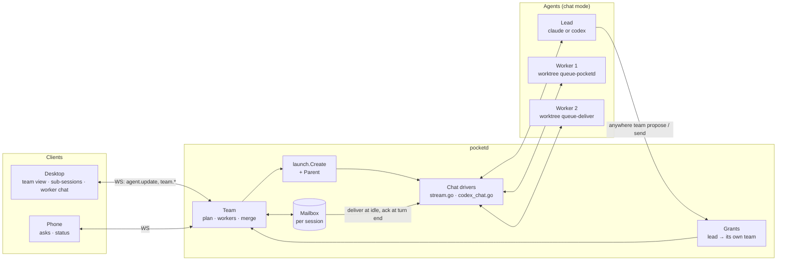
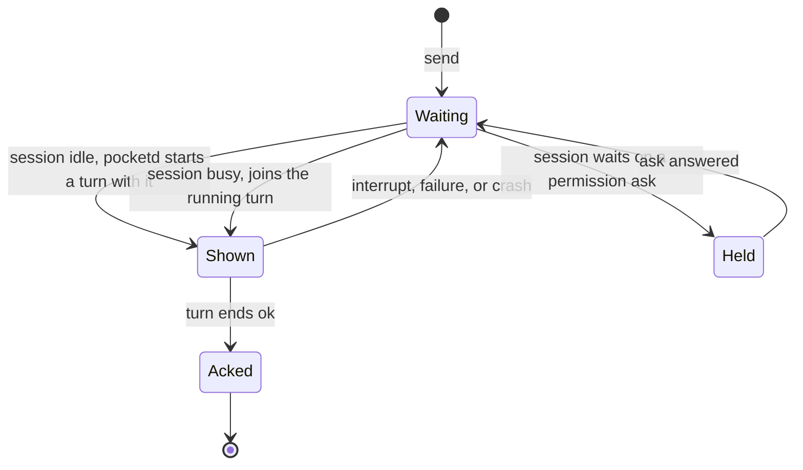
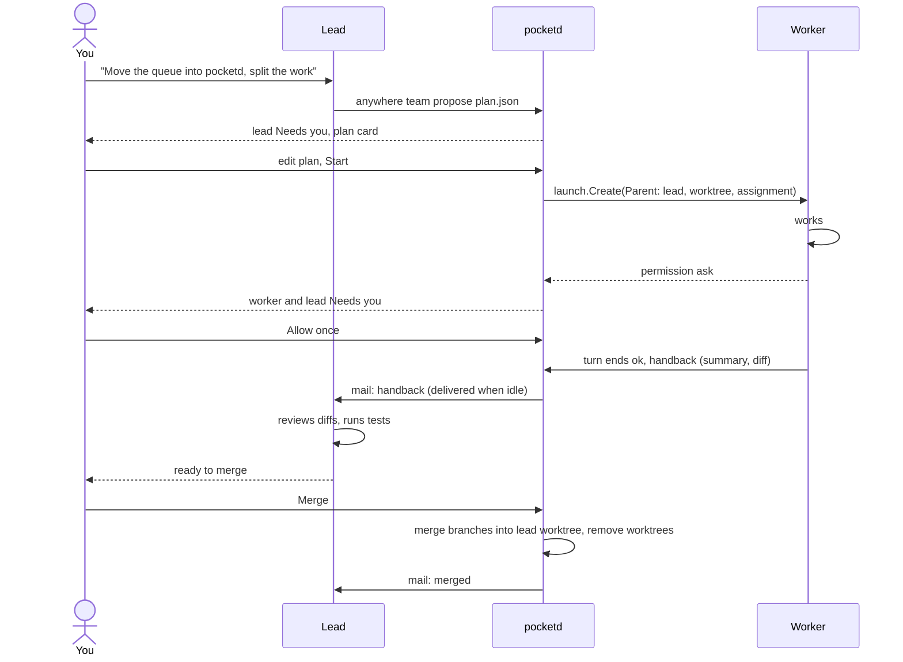

# 08 Orchestrator mode: a lead and its workers

Status: proposal. Prototype: `.ui-review/prototypes/orchestrator-team.html`.

One agent, the **lead**, splits a task into parts. Each part runs as a **worker**: a normal chat session in its own worktree, listed under the lead as a sub-session. Workers hand their results back to the lead. You approve the plan, answer every permission ask, and decide when to merge.

This page explains how the pieces fit and why they are cut this way. It draws on three sources: piggery (github.com/sting8k/piggery), MonoCode's orchestrator (github.com/hardbeat920/monocode), and what pocketd already does.

## What you see

1. You ask the lead for something big. The lead answers with a plan: tasks, each with an agent, a model, a worktree, the files it may touch, and what it waits for.
2. The lead goes **Needs you**. You edit the plan and click **Start**.
3. Workers appear under the lead in the sidebar. Click one to open its chat. ⌘-click opens it beside the lead.
4. A worker that asks for a permission goes **Needs you**, and so does the lead. You answer in the worker's chat, the team view, the notch, or the phone.
5. Each worker hands back a summary and a diff. When all have, the lead reviews them and asks you to merge.
6. You click **Merge**. Branches go into the lead's worktree, worker worktrees are removed, and branches stay.

## The pieces

Three layers, each usable without the next:

| Layer | What it adds | Usable alone for |
|---|---|---|
| Grants | A session may drive the sessions you allow it to | `anywhere` CLI from inside an agent (E15) |
| Mailbox | Messages to a session wait in pocketd and are acked only when a turn ends normally | Queued sends that survive closing the app |
| Team | Plan, workers as sub-sessions, handbacks, merge | Orchestrator mode |

MonoCode built its orchestrator and its agent CLI as two separate stacks, and its own issue #956 asks to rebuild one on the other. Building grants and the mailbox first, then the team on top, avoids that.

## Grants: who may drive whom

Today every process under an Anywhere terminal, chat sessions included, gets only the `observe` scope. `peer/classify.go` walks the caller's process ancestry, and `peer/check.go` maps each verb to a scope. A lead that wants to message its workers is exactly such a process, so it needs a grant.

A grant follows R9 in `research/18-trust-model.md`:

- You issue it, per session. It is off by default.
- It names scopes from `observe`, `drive`, and `notify`. It never holds `approve`, and it never passes to a session the holder starts.
- Its token is in the session's environment only while the grant lives.

The lead gets one grant, limited to its own team: send to its workers, read them, and propose a plan. It does not get `spawn`. Your click on **Start** is the spawn, and pocketd starts the workers as the owner. Workers get no grant at all. This keeps the prompt-injection surface where the trust model wants it: an agent can suggest work but cannot start, approve, or merge anything.

## Workers are sessions with a parent

A worker is a chat session made by `launch.Create`, like any other. Two things are new:

- `LaunchSpec` gets `Parent`, the lead's session id. Today the spec has no origin or parent field, and the origin in `launch.go` is only `desktop` or `phone`.
- The registry keeps the parent link and sends it in `agent.update`, so every client can nest workers under their lead.

Each worker's worktree is created from the lead's branch, under `~/.anywhere/worktrees/<project>/`. It is not listed again under the project's worktrees. Workers run in chat mode, because pocketd can already send them a prompt (`stream.go` writes a stream-json line, `codex_chat.go` calls `turn/start`) and see their turn end (`result`, `turn/completed`). A worker in a PTY would need prompts typed into a TUI, which is the fragile path piggery works around.

## The mailbox: deliver at idle, ack at turn end

Messages between the lead and its workers, and your notes to the lead, go through a mailbox in pocketd. Today the only queue is the desktop's `Outgoing` in `crates/chat/src/outgoing.rs`, so closing the window drops what waits there.

The rule comes from piggery, and it is the one piece worth copying as-is: a message counts as read only when the turn that showed it ends normally. An interrupt, a failure, or a crash leaves it unread, and it comes again.

Three details piggery learned the hard way, which apply here unchanged:

- Key the ack to the turn that showed the message, not to "the next turn end". Otherwise an interrupted turn followed by a new one acks mail the model never finished.
- Keep each delivery under about 9,000 characters. Claude moves larger hook context into a file the model may never open.
- Tell the model in its instructions that team messages are a legitimate channel. Without that line, models refuse them as prompt injection.

## One run, end to end

When you message a worker directly, pocketd sends it to that worker's chat and also leaves a note in the lead's mailbox, "You told Sonnet 5.5 on …". The lead then reviews against what the worker was actually told, not against the original plan.

## Permissions stay yours

A worker's permission ask is a normal ask on a normal session. It shows on that worker, on the lead (whose status is its most urgent worker's), in the notch, and on the phone. Only you answer it, as D19 requires.

MonoCode lets the lead answer its workers' asks. That saves clicks, but it hands `approve` to an agent, which is the one scope the trust model never grants. A plan-time allowlist is the better lever: the plan can say which commands a worker may run, and you approve that list once when you click **Start**.

## Where the code goes

The split follows `docs/adr/0003-desktop-code-layout.md`.

| Where | What |
|---|---|
| `pocketd/internal/peer` | Grants: issue, check, revoke. New rows in `check.go` |
| `pocketd/internal/proto` | `LaunchSpec.Parent`, `team.*` verbs, team fields on `agent.update` |
| `pocketd/internal/launch` | Worker launch: worktree from the lead's branch, assignment prompt |
| `pocketd/internal/team` (new) | Plan validation, dependency order, concurrency, handbacks, merge |
| `pocketd/internal/mailbox` (new) | Durable queue, delivery through the chat drivers, ack by turn |
| `desktop/crates/agents` | Parent links and the team snapshot as plain data |
| `desktop/crates/pocket/src/team` (new) | The plan card and the team view |
| `desktop/crates/pocket/src/sidebar/sections` | Sub-session rows under the lead |
| `desktop/crates/pocket/src/chat` | Worker chat: breadcrumb back to the lead, open beside |

`CONTEXT.md` needs **Lead**, **Worker**, and **Team** before any code, as `strategy/C-control-plane.md` asked. Don't call a team's work a "run": **Run** already means one firing of an automation.

## Build order

1. Grants in pocketd, with red-team cases for a granted session reaching outside its grant.
2. `LaunchSpec.Parent` and sub-session rows in the sidebar. Useful on its own: a session started by the `anywhere` CLI from another session nests under it.
3. The mailbox, used first by the composer's queue so queued sends survive closing the app.
4. Team: propose, plan card, Start, handbacks, merge.
5. Phone: sub-sessions and team status.

## Open questions

- **Merge.** Git merge of each worker branch, in dependency order, with conflicts sent back to the lead? Or MonoCode's file-delta copy, which its own issue #564 calls fragile? Git merge is the safer default.
- **Write scope.** Enforce the plan's file list with a `PreToolUse` deny, or only state it in the prompt? Enforcing it is cheap with the hooks pocketd already installs, but only for Claude.
- **Plan allowlist.** Approving a list of commands at **Start** cuts asks a lot. It is still `approve` given ahead of time, so it needs its own decision against D19.
- **Size limits.** The trust model suggests 8 workers, a queue of 32, and at most 24 pending. The prototype caps parallel workers at 4.
